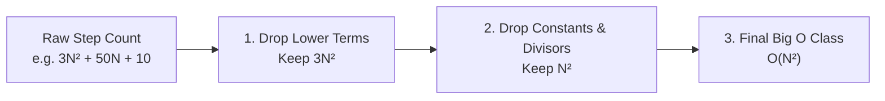

# Time and space complexity: Big O notation

> **Topic:** Big O notation and counting elementary steps  
> **Cohort lecture:** Airtribe DSA, Session 1 (Aakash Verma)  
> **Core concept:** Growth rate as $N \to \infty$  

## 1. What Big O means

Big O measures the mathematical rate of growth of an algorithm as the input size $N$ scales up. If $N$ gets $1,000\times$ larger, Big O tells you how much more work the CPU has to do.

```text
Complexity Ladder (Fastest ──> Slowest):
O(1)  <  O(log N)  <  O(N)  <  O(N log N)  <  O(N²)  <  O(2ᴺ)  <  O(N!)
Instant   Halving   One Pass    Sorting       Nested    Binary   Permutations
```

## 2. Three rules for simplifying Big O

When counting CPU steps, simplify the expression using three rules:

### Rule 1: Drop constants
Constant multipliers do not change the growth class:
* $3N \implies \mathcal{O}(N)$
* $100N \implies \mathcal{O}(N)$

### Rule 2: Drop constant divisors
Dividing by a constant is still linear growth:
* $\frac{N}{2} \implies \mathcal{O}(N)$
* $\frac{N}{10} \implies \mathcal{O}(N)$

### Rule 3: Keep only the dominant term
When $N = 1,000,000$, $N^2 = 1,000,000,000,000$. The lower-order terms barely register at scale:
* $N^2 + N \implies \mathcal{O}(N^2)$
* $N^3 + 500N^2 + 10 \implies \mathcal{O}(N^3)$



## 3. How to calculate time complexity from loops

Count how many times the innermost line of code executes as a function of $N$.

### Pattern A: Single pass $\implies \mathcal{O}(N)$
```python
total = 0
for x in arr:        # Runs N times
    total += x       # 1 step per pass
# Total = N steps -> O(N)
```

### Pattern B: Halving or doubling loop $\implies \mathcal{O}(\log N)$
Whenever the loop counter multiplies or divides by a constant factor (like 2), the remaining search space halves on each step:
```python
i = len(arr) - 1
while i >= 1:
    total += arr[i]
    i //= 2          # 16 -> 8 -> 4 -> 2 -> 1 (4 steps)
# 2^k = N  ==>  k = log₂(N)  ==>  O(log N)
```

### Pattern C: Independent nested loops $\implies \mathcal{O}(N^2)$
```python
for i in range(n):       # Runs N times
    for j in range(n):   # Runs N times for every i
        print(i, j)
# Total = N * N = O(N²)
```

### Pattern D: Shrinking triangle loop $\implies \mathcal{O}(N^2)$
The inner loop starts at `i` and shrinks by 1 step each round:
```python
for i in range(n):
    for j in range(i, n):   # Runs N, then N-1, then N-2... down to 1
        print(i, j)
```
$$\text{Total steps} = N + (N - 1) + (N - 2) + \dots + 1 = \frac{N(N + 1)}{2} = \frac{N^2 + N}{2} \implies \mathcal{O}(N^2)$$

### Pattern E: Nested doubling loop $\implies \mathcal{O}(N \log N)$
```python
for i in range(1, len(arr)):    # Runs N times
    j = 1
    while j < len(arr):         # Runs log(N) times (doubles: 1, 2, 4, 8...)
        print("Second loop")
        j *= 2
# Total = N * log(N) ==> O(N log N)
```

### Pattern F: Early break inside a loop $\implies \mathcal{O}(N^2)$ instead of $\mathcal{O}(N^3)$
```python
for i in range(1, len(arr)):        # Runs N times
    for j in range(1, len(arr)):    # Runs N times
        for k in range(1, len(arr)):
            break                   # Exits on step 1
# Total = N * N * 1 = O(N²)
```

## 4. Space complexity: auxiliary memory

In interviews, space complexity refers to **auxiliary space**, which is the extra memory your algorithm allocates beyond the input data itself.

| Memory allocation | Auxiliary space | Example |
|---|:---:|---|
| A few scalar variables (`total`, `i`, `left`) | $\mathcal{O}(1)$ | Two pointers, in-place swaps |
| A new collection storing $N$ items | $\mathcal{O}(N)$ | `prefix = []`, `seen = set()` |
| A 2D grid of size $N \times N$ | $\mathcal{O}(N^2)$ | Dynamic programming matrix |
| Recursive call stack of depth $N$ | $\mathcal{O}(N)$ | DFS on an unbalanced tree |

Modifying an input array in-place (when the problem allows it) keeps auxiliary space at $\mathcal{O}(1)$ instead of $\mathcal{O}(N)$.
