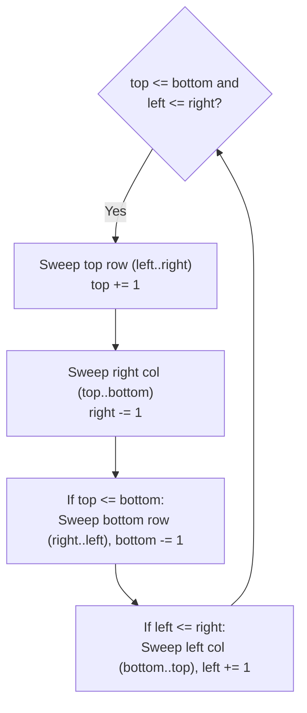

# 2D matrices, diagonals, and in-place rotations

> **Course reference:** CodeKerdos DSA, Class 7
> **Core concepts:** Diagonal coordinate invariants ($i+j$, $i-j$), in-place matrix transpose, 90-degree rotations, and 4-pointer spiral traversal.

## Diagonals and coordinate invariants

In Python, a 2D matrix is a list of lists where `rows = len(matrix)`, `cols = len(matrix[0])`, and `matrix[r][c]` accesses row `r`, column `c`. For an $N \times N$ square matrix:

1. **Principal diagonal (top-left to bottom-right):** Row index equals column index ($i == j$).
2. **Anti-diagonal (top-right to bottom-left):** Row plus column index is constant ($i + j == N - 1$).
3. **All right-to-left diagonals:** There are $2N - 1$ diagonals in total. Every cell on the same anti-diagonal shares the same coordinate sum $s = i + j$ for $0 \le s \le 2N - 2$.

<details>
<summary>Spoiler: Solution Code</summary>

```python
def print_all_anti_diagonals(matrix: list[list[int]]) -> list[list[int]]:
    n = len(matrix)
    result = []
    for s in range(2 * n - 1):
        diagonal = []
        for i in range(n):
            j = s - i
            if 0 <= j < n:
                diagonal.append(matrix[i][j])
        result.append(diagonal)
    return result
```

</details>

## In-place matrix transpose and 90-degree rotations

Transposing a matrix swaps rows and columns (`matrix[i][j] <-> matrix[j][i]`). If your loop visits every cell $(i, j)$, you will swap `(0, 1)` with `(1, 0)` and later swap `(1, 0)` back with `(0, 1)`, undoing your work. Always restrict the inner loop to the upper triangle above the main diagonal ($j > i$).

To rotate an $N \times N$ matrix 90 degrees in $\mathcal{O}(1)$ extra space:
* **90 degrees clockwise:** Transpose in-place, then reverse each row (`row.reverse()`).
* **90 degrees counter-clockwise:** Transpose in-place, then reverse the order of rows (`matrix.reverse()`).

```text
Original          Transpose         Reverse Rows (90° CW)
[ 1, 2, 3 ]       [ 1, 4, 7 ]       [ 7, 4, 1 ]
[ 4, 5, 6 ]  -->  [ 2, 5, 8 ]  -->  [ 8, 5, 2 ]
[ 7, 8, 9 ]       [ 3, 6, 9 ]       [ 9, 6, 3 ]
```

<details>
<summary>Spoiler: Solution Code</summary>

```python
def rotate_90_clockwise(matrix: list[list[int]]) -> None:
    n = len(matrix)
    for i in range(n):
        for j in range(i + 1, n):
            matrix[i][j], matrix[j][i] = matrix[j][i], matrix[i][j]

    for row in matrix:
        row.reverse()
```

</details>

## Spiral matrix traversal (LeetCode 54)

Maintain four boundaries: `top = 0`, `bottom = m - 1`, `left = 0`, `right = n - 1`. In each iteration, sweep all four sides and shrink the corresponding boundary inward:

1. Sweep left to right along `top`, then `top += 1`.
2. Sweep top to bottom along `right`, then `right -= 1`.
3. If `top <= bottom`, sweep right to left along `bottom`, then `bottom -= 1`.
4. If `left <= right`, sweep bottom to top along `left`, then `left += 1`.

The `top <= bottom` and `left <= right` checks before steps 3 and 4 prevent double-counting when a non-square matrix reduces to a single remaining row or column.



<details>
<summary>Spoiler: Solution Code</summary>

```python
def spiralOrder(matrix: list[list[int]]) -> list[int]:
    if not matrix or not matrix[0]:
        return []

    top, bottom = 0, len(matrix) - 1
    left, right = 0, len(matrix[0]) - 1
    result = []

    while top <= bottom and left <= right:
        for c in range(left, right + 1):
            result.append(matrix[top][c])
        top += 1

        for r in range(top, bottom + 1):
            result.append(matrix[r][right])
        right -= 1

        if top <= bottom:
            for c in range(right, left - 1, -1):
                result.append(matrix[bottom][c])
            bottom -= 1

        if left <= right:
            for r in range(bottom, top - 1, -1):
                result.append(matrix[r][left])
            left += 1

    return result
```

</details>

* **Time complexity:** $\mathcal{O}(M \times N)$ for spiral traversal, $\mathcal{O}(N^2)$ for transpose and rotation.
* **Space complexity:** $\mathcal{O}(1)$ auxiliary space.
