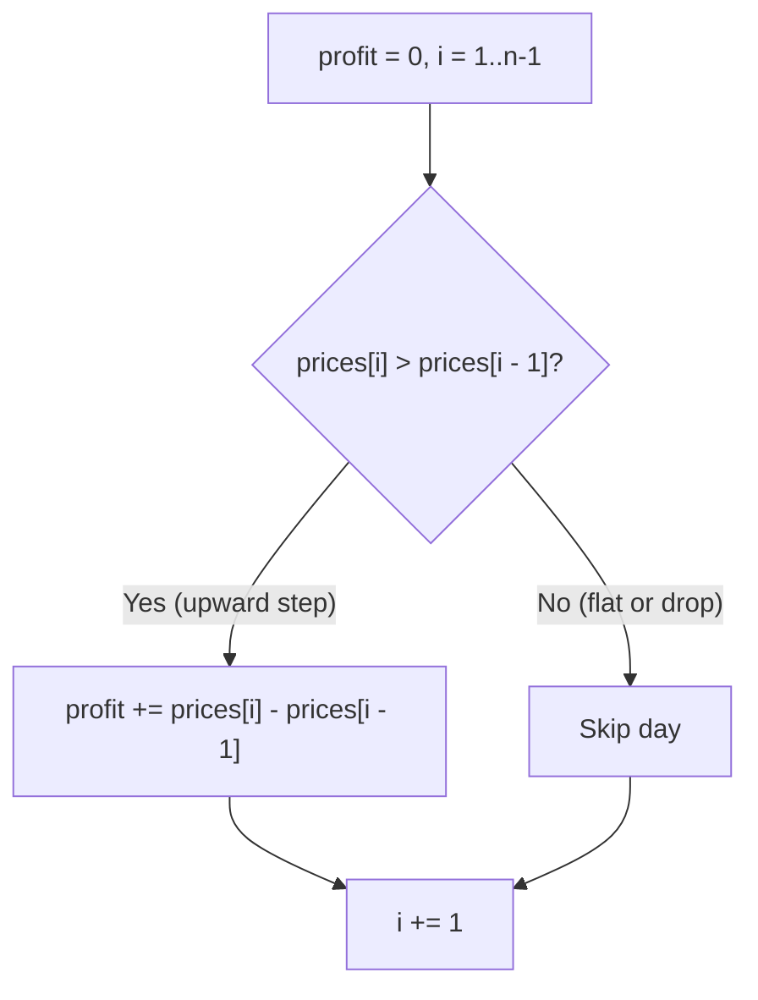

# LeetCode 122: Best Time to Buy and Sell Stock II

> **Difficulty:** Medium | **Pattern:** Greedy (Daily Step Accumulation)
> **Link:** [LeetCode 122](https://leetcode.com/problems/best-time-to-buy-and-sell-stock-ii/)

## The problem

Given an integer array `prices` where `prices[i]` is the stock price on day $i$, find the maximum profit you can achieve with unlimited transactions. You may hold at most one share at a time, and you can buy and sell on the same day.

## Why the naive way fails

Tracking local valleys and peaks with state variables requires extra boundary checks at the end of the array, and trying all buy/sell combinations via recursion or DP takes $\mathcal{O}(n^2)$ or unnecessary $\mathcal{O}(n)$ state space.

## The core trick

Any multi-day upward run $A \le B \le C$ telescopes into the sum of its daily increases:

$$C - A = (B - A) + (C - B)$$

For `[1, 2, 5]`, buying at `1` and selling at `5` gives $5 - 1 = 4$. Collecting every positive daily step gives $(2 - 1) + (5 - 2) = 1 + 3 = 4$. You do not need to track where a valley started. Whenever `prices[i] > prices[i - 1]`, add `prices[i] - prices[i - 1]` to `profit`.

```text
Prices:       [ 7,     1,     5,     3,     6,     4 ]
Daily change:     -6     +4     -2     +3     -2
Action:          skip   take   skip   take   skip
Total profit = 4 + 3 = 7
```



## Step-by-step trace

Input: `prices = [7, 1, 5, 3, 6, 4]`

| Day $i$ | `prices[i - 1]` | `prices[i]` | Diff | Action | `profit` |
|---|---|---|---|---|---|
| 1 | 7 | 1 | -6 | Ignore drop | 0 |
| 2 | 1 | 5 | +4 | Add +4 | 4 |
| 3 | 5 | 3 | -2 | Ignore drop | 4 |
| 4 | 3 | 6 | +3 | Add +3 | 7 |
| 5 | 6 | 4 | -2 | Ignore drop | 7 |

<details>
<summary>Spoiler: Solution Code</summary>

```python
class Solution:
    def maxProfit(self, prices: list[int]) -> int:
        profit = 0

        for i in range(1, len(prices)):
            if prices[i] > prices[i - 1]:
                profit += prices[i] - prices[i - 1]

        return profit
```

</details>

## Traps to watch for

* **Confusing Stock II with Kadane's algorithm:** Kadane's algorithm finds a single contiguous subarray (which corresponds to Stock I, LC 121). Stock II lets you take every positive step and skip every negative step independently.
* **Same-day buy and sell:** Even if an interviewer disallows buying and selling on the same day, the telescoping sum `(B - A) + (C - B)` still computes the exact profit of buying once at `A` and selling once at `C`.

## Complexity

* **Time:** $\mathcal{O}(n)$ for a single linear pass.
* **Space:** $\mathcal{O}(1)$ auxiliary memory.
