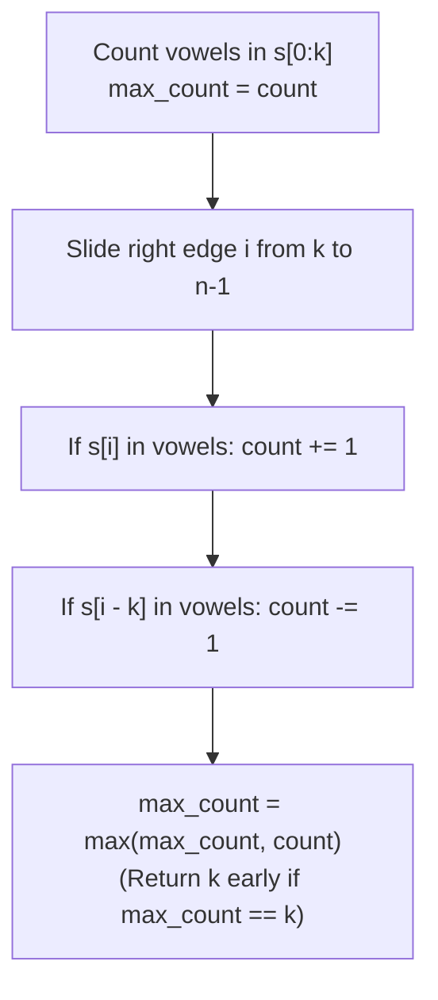

# LeetCode 1456: Maximum Number of Vowels in a Substring of Given Length

> **Difficulty:** Medium | **Pattern:** Fixed-Size Sliding Window (Running Differential)
> **Link:** [LeetCode 1456](https://leetcode.com/problems/maximum-number-of-vowels-in-a-substring-of-given-length/)

## The problem

Given a string `s` and an integer `k`, return the maximum number of vowel letters (`'a'`, `'e'`, `'i'`, `'o'`, `'u'`) in any contiguous substring of `s` with length `k`.

## Why the naive way fails

Slicing `s[i : i + k]` and counting vowels inside each slice takes $\mathcal{O}(k)$ work per window. When $\text{len}(s) = 10^5$ and $k = 5 \times 10^4$, that is $(5 \times 10^4)^2 = 2.5 \times 10^9$ operations, causing a Time Limit Exceeded error.

## The core trick

Maintain a running `count` of vowels inside a fixed window of size $k$. Count vowels in the initial window `s[0:k]`. Then slide the right edge `i` from `k` to `len(s) - 1`, doing two $\mathcal{O}(1)$ updates at each step:
1. **Add the entering character:** If `s[i]` is a vowel, increment `count += 1`.
2. **Subtract the leaving character:** If `s[i - k]` is a vowel, decrement `count -= 1`.

```text
s = "a  b  c  i  i  i  d  e  f",  k = 3
    [a  b  c]                     initial window (count = 1)
     -  [b  c  i]                 'a' leaves (-1), 'i' enters (+1) -> count = 1
```



## Step-by-step trace

Input: `s = "abciiidef"`, `k = 3` (initial window `"abc"` has `count = 1`, `max_count = 1`)

| Right index $i$ | Entering `s[i]` | Leaving `s[i - 3]` | Window | `count` | `max_count` |
|---|---|---|---|---|---|
| 3 | `'i'` (+1) | `'a'` (-1) | `"bci"` | 1 | 1 |
| 4 | `'i'` (+1) | `'b'` (0) | `"cii"` | 2 | 2 |
| 5 | `'i'` (+1) | `'c'` (0) | `"iii"` | 3 | 3 (early exit: `== k`) |

<details>
<summary>Spoiler: Solution Code</summary>

```python
class Solution:
    def maxVowels(self, s: str, k: int) -> int:
        vowels = {"a", "e", "i", "o", "u"}

        count = sum(1 for i in range(k) if s[i] in vowels)
        max_count = count
        if max_count == k:
            return k

        for i in range(k, len(s)):
            if s[i] in vowels:
                count += 1
            if s[i - k] in vowels:
                count -= 1

            if count > max_count:
                max_count = count
                if max_count == k:
                    return k

        return max_count
```

</details>

## Traps to watch for

* **Writing `s[k]` instead of `s[i]`:** Inside the sliding loop, the entering character is `s[i]`, not `s[k]`. Using `s[k]` re-checks the fixed index `k` on every iteration.
* **Thinking `count` can go negative:** Every leaving character `s[i - k]` entered the window $k$ steps earlier. If `s[i - k]` is a vowel, it previously incremented `count`, so `0 <= count <= k` always holds without clamping.

## Complexity

* **Time:** $\mathcal{O}(n)$ with $\mathcal{O}(1)$ set lookups per character.
* **Space:** $\mathcal{O}(1)$ for the 5-element vowel set.
