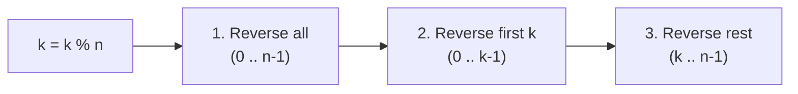

# LeetCode 189: Rotate Array

> **Difficulty:** Medium | **Pattern:** Two Pointers (Triple Reversal in $\mathcal{O}(1)$ Space)
> **Link:** [LeetCode 189](https://leetcode.com/problems/rotate-array/)

## The problem

Given an integer array `nums`, rotate the array to the right by `k` steps in-place.

## Why the naive way fails

Shifting the array right by 1 step `k` times takes $\mathcal{O}(n \times k)$ time and times out. Slicing (`nums[:] = nums[n - k:] + nums[:n - k]`) runs in $\mathcal{O}(n)$ time, but allocates three temporary lists totaling $\mathcal{O}(n)$ extra memory, failing the $\mathcal{O}(1)$ space follow-up.

## The core trick

First normalize `k %= len(nums)` since rotating by $n$ steps returns the array to its starting order. Rotating right by $k$ moves the last $k$ elements (Part B) to the front and shifts the first $n - k$ elements (Part A) to the back. You can achieve this in $\mathcal{O}(1)$ extra space with three in-place two-pointer reversals:

```text
Original:                  [ 1, 2, 3, 4 | 5, 6, 7 ]   (k = 3)
1. Reverse entire array:   [ 7, 6, 5 | 4, 3, 2, 1 ]
2. Reverse first k:        [ 5, 6, 7 | 4, 3, 2, 1 ]
3. Reverse remaining n-k:  [ 5, 6, 7 | 1, 2, 3, 4 ]
```



## Step-by-step trace

Input: `nums = [1, 2, 3, 4, 5, 6, 7]`, `k = 3` (`n = 7`, `k %= 7 -> 3`)

| Operation | Slice indices | Array state after step |
|---|---|---|
| Initial state | - | `[1, 2, 3, 4, 5, 6, 7]` |
| `reverse_sub(0, 6)` | `0..6` (all) | `[7, 6, 5, 4, 3, 2, 1]` |
| `reverse_sub(0, 2)` | `0..2` (first $k$) | `[5, 6, 7, 4, 3, 2, 1]` |
| `reverse_sub(3, 6)` | `3..6` (last $n - k$) | `[5, 6, 7, 1, 2, 3, 4]` |

<details>
<summary>Spoiler: Solution Code</summary>

```python
class Solution:
    def rotate(self, nums: list[int], k: int) -> None:
        n = len(nums)
        k %= n

        def reverse_sub(start: int, end: int) -> None:
            while start < end:
                nums[start], nums[end] = nums[end], nums[start]
                start += 1
                end -= 1

        reverse_sub(0, n - 1)
        reverse_sub(0, k - 1)
        reverse_sub(k, n - 1)
```

</details>

## Traps to watch for

* **Forgetting `k %= len(nums)`:** When $k \ge n$ (for example `nums = [1, 2]`, `k = 3`), `reverse_sub(0, k - 1)` will raise an `IndexError` unless you take `k %= n` first.
* **Rebinding `nums = ...` instead of mutating in-place:** If you ever use the Python slice shortcut, `nums = nums[-k:] + nums[:-k]` only rebinds the local variable `nums` and leaves the caller's list unchanged. Use `nums[:] = ...` (or the $\mathcal{O}(1)$-space triple reversal above).

## Complexity

* **Time:** $\mathcal{O}(n)$ because each element is swapped at most twice (once in the full reversal, once in the sub-slice reversal).
* **Space:** $\mathcal{O}(1)$ auxiliary memory.
