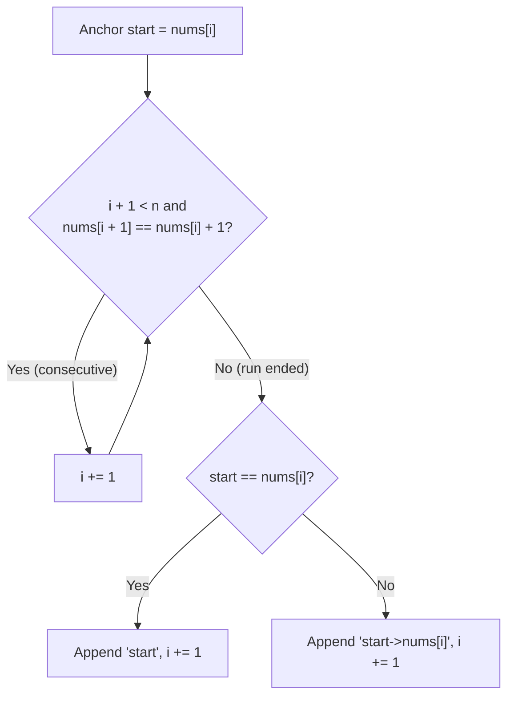

# LeetCode 228: Summary Ranges

> **Difficulty:** Easy | **Pattern:** Two Pointers (Anchor and Scout)  
> **LeetCode:** [228. Summary Ranges](https://leetcode.com/problems/summary-ranges/)

## The problem

Given a sorted unique integer array `nums`, group contiguous numbers into ranges `[a, b]`:
- Format as `"a->b"` if `a != b`, or `"a"` if `a == b`.
- Every number in `nums` must belong to one range, and no missing numbers can sit inside a range.

```text
Input:  nums = [0, 1, 2, 4, 5, 7]
Output: ["0->2", "4->5", "7"]
```

## Why a single `for` loop gets messy

In a standard `for i in range(len(nums))` loop, you usually look backward (`nums[i] - nums[i-1] != 1`) to detect where a run broke. That creates two headaches:
1. Off-by-one confusion over whether the range ended at `nums[i-1]` or `nums[i]`.
2. The final range gets stranded when the loop ends because there is no next number to trigger the `else` branch, forcing you to duplicate the append logic after the loop.

## The core trick: Anchor and Scout

Instead of looking backward, drop an anchor at the start of a run and use an inner `while` loop to scout ahead as long as the next number is consecutive (`nums[i + 1] == nums[i] + 1`).

```text
nums = [ 0 , 1 , 2 , 4 , 5 , 7 ]
         ^       ^
       start     i (stops here because 4 != 2 + 1) -> records "0->2"
```



| Round | Anchor (`start`) | Scout (`i`) moves | Stops at `nums[i]` | Appended | Next `i` |
| :--- | :--- | :--- | :--- | :--- | :--- |
| 1 | `nums[0] = 0` | `0 -> 1 -> 2` | `2` (`4 != 2 + 1`) | `"0->2"` | `3` |
| 2 | `nums[3] = 4` | `3 -> 4` | `5` (`7 != 5 + 1`) | `"4->5"` | `5` |
| 3 | `nums[5] = 7` | stays at `5` | `7` (end of array) | `"7"` | `6` (done) |

When the inner `while` loop stops, `nums[i]` is the exact end of the current range. That handles single-element ranges, the final range, and even an empty array `[]` without extra cleanup after the loop.

## Solution

<details>
<summary>Spoiler: Solution Code</summary>

```python
class Solution:
    def summaryRanges(self, nums: list[int]) -> list[str]:
        res = []
        i = 0
        n = len(nums)

        while i < n:
            start = nums[i]

            # Advance i while the next number is consecutive
            while i + 1 < n and nums[i + 1] == nums[i] + 1:
                i += 1

            if start == nums[i]:
                res.append(str(start))
            else:
                res.append(f"{start}->{nums[i]}")

            i += 1

        return res
```

</details>

## Complexity

| Metric | Value | Notes |
| :--- | :--- | :--- |
| **Time** | $\mathcal{O}(n)$ | Even with a nested `while` loop, pointer `i` only moves forward and visits each index once. |
| **Space** | $\mathcal{O}(1)$ | Only a few scalar variables outside the output list. |

## Related problems

This same Anchor and Scout structure works whenever you need to compress contiguous runs:
- **LC 443: String Compression** (count consecutive identical characters)
- **LC 56: Merge Intervals** (group overlapping sorted intervals)
- **LC 1869: Longer Contiguous Segments of Ones than Zeros**
