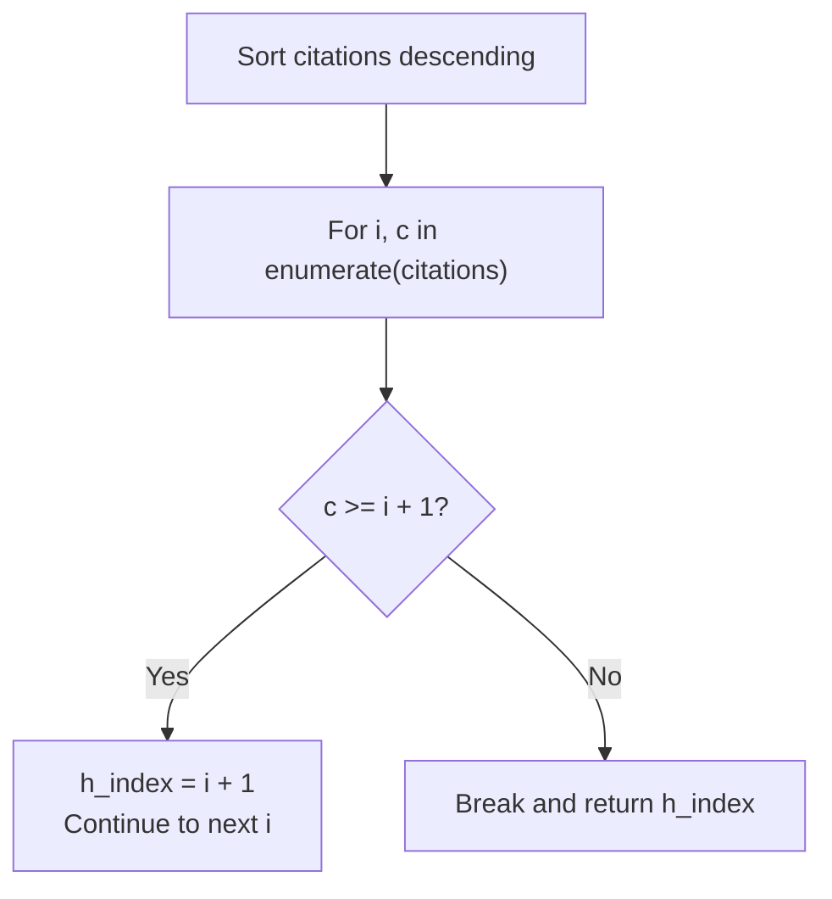

# LeetCode 274: H-Index

> **Difficulty:** Medium | **Pattern:** Sorting + Rank Comparison  
> **Source Code:** [`274_h_index.py`](./274_h_index.py)

## The problem

Given an integer array `citations` where `citations[i]` is the citation count for a researcher's $i$-th paper, return their $h$-index.

A researcher has index $h$ if at least $h$ of their papers have at least $h$ citations each.

```text
Example 1:
Input:  citations = [3, 0, 6, 1, 5]
Output: 3

Example 2:
Input:  citations = [100]
Output: 1
```

## The core trick: Sort descending and compare against 1-based rank

If you sort `citations` from highest to lowest, each index `i` gives a 1-based paper count `rank = i + 1`:
- At index `i`, you have seen `i + 1` papers with at least `citations[i]` citations.
- As long as `citations[i] >= i + 1`, you have at least `i + 1` papers with `i + 1` or more citations.
- The first time `citations[i] < i + 1`, stop immediately (`break`). Since the list is sorted descending, every paper after it has even fewer citations while the required rank keeps growing.



## Step-by-step trace

Sorting `citations = [3, 0, 6, 1, 5]` in descending order gives `[6, 5, 3, 1, 0]`:

| Index `i` | Rank (`i + 1`) | Citations `c` | `c >= i + 1`? | `h_index` |
| :--- | :--- | :--- | :--- | :--- |
| `0` | `1` | `6` | `6 >= 1` (True) | `1` |
| `1` | `2` | `5` | `5 >= 2` (True) | `2` |
| `2` | `3` | `3` | `3 >= 3` (True) | `3` |
| `3` | `4` | `1` | `1 >= 4` (False, break) | `3` |

## Solution

<details>
<summary>Spoiler: Solution Code</summary>

```python
from typing import List

class Solution:
    def hIndex(self, citations: List[int]) -> int:
        citations.sort(reverse=True)
        h_index = 0

        for i, c in enumerate(citations):
            if c >= i + 1:
                h_index = i + 1
            else:
                break

        return h_index
```

</details>

## Complexity

| Metric | Value | Notes |
| :--- | :--- | :--- |
| **Time** | $\mathcal{O}(n \log n)$ | Sorting takes $\mathcal{O}(n \log n)$ and the scan takes $\mathcal{O}(n)$. (Can be reduced to $\mathcal{O}(n)$ time and $\mathcal{O}(n)$ space with bucket/counting sort capped at $n$). |
| **Space** | $\mathcal{O}(1)$ | Sorts the array in-place. |
