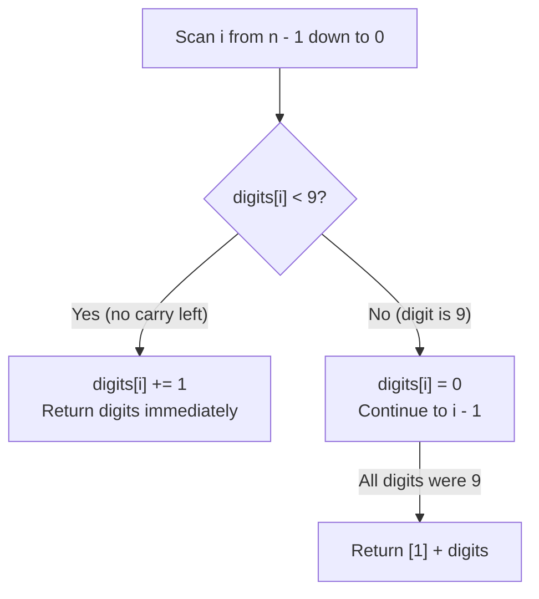

# LeetCode 66: Plus One

> **Difficulty:** Easy | **Pattern:** Schoolbook Carry Addition (Right-to-Left Scan)  
> **LeetCode:** [66. Plus One](https://leetcode.com/problems/plus-one/)

## The problem

Given a large integer represented as an array of `digits` ordered from most significant to least significant (left to right), increment the integer by one and return the resulting array of digits.

```text
Input:  digits = [1, 2, 3] -> Output: [1, 2, 4]
Input:  digits = [1, 2, 9] -> Output: [1, 3, 0]
Input:  digits = [9, 9, 9] -> Output: [1, 0, 0, 0]
```

## Why string conversion fails in interviews

Writing `[int(x) for x in str(int("".join(map(str, digits))) + 1)]` works in Python because Python supports arbitrary-precision integers, but interviewers reject it for two reasons:
1. **Integer overflow in fixed-width languages:** In C++, Java, or Go, 64-bit integers overflow around 19 digits, whereas `digits` can have up to 100 elements.
2. **Extra allocations:** Converting the array to a string, parsing an integer, converting back to a string, and building a new list allocates $\mathcal{O}(n)$ temporary memory even when only the last digit changes.

## The core trick: Car odometer rollover

Walk backward from the last digit (`len(digits) - 1` down to `0`):
- **Digit is less than `9`:** Increment `digits[i] += 1` and return `digits` immediately. No carry propagates further left.
- **Digit is `9`:** Set `digits[i] = 0` and let the loop continue to carry `+1` into the next digit to the left.
- **All digits were `9`:** If the loop finishes without returning, every digit rolled over to `0` (for example, `[9, 9, 9]` became `[0, 0, 0]`). Prepend `1` by returning `[1] + digits`.

```text
Case 1: [ 1, 2, 3 ] -> bump 3 to 4 -> return [ 1, 2, 4 ] immediately
Case 2: [ 1, 2, 9 ] -> 9 becomes 0, bump 2 to 3 -> return [ 1, 3, 0 ] immediately
Case 3: [ 9, 9, 9 ] -> rolls to [ 0, 0, 0 ] -> loop ends -> return [ 1, 0, 0, 0 ]
```



## Solution

<details>
<summary>Spoiler: Solution Code</summary>

```python
class Solution:
    def plusOne(self, digits: list[int]) -> list[int]:
        for i in range(len(digits) - 1, -1, -1):
            if digits[i] < 9:
                digits[i] += 1
                return digits
            digits[i] = 0

        return [1] + digits
```

</details>

## Complexity

| Metric | Value | Notes |
| :--- | :--- | :--- |
| **Time** | $\mathcal{O}(1)$ best / $\mathcal{O}(n)$ worst | Exits on the first step whenever the last digit is not `9`; scans all $n$ digits only when the number ends in a run of `9`s. |
| **Space** | $\mathcal{O}(1)$ in-place ($\mathcal{O}(n)$ all-9s) | Mutates `digits` in-place unless all digits are `9`, which requires allocating a list of length $n + 1$. |
