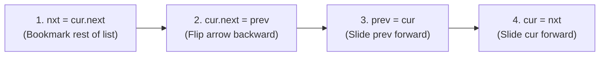

# LeetCode 206: Reverse Linked List

> **Pattern:** In-place 3-pointer flip  
> **Difficulty:** Easy  
> **Link:** [LeetCode 206](https://leetcode.com/problems/reverse-linked-list/)

## The problem

Given the `head` of a singly linked list, reverse the list in-place and return the new head.

```text
Input:  [ 1 ] ──► [ 2 ] ──► [ 3 ] ──► [ 4 ] ──► [ 5 ] ──► None
Output: [ 5 ] ──► [ 4 ] ──► [ 3 ] ──► [ 2 ] ──► [ 1 ] ──► None
```

## The core trick

Picture a line of people where each person holds the backpack of the person in front of them (`cur.next`). If `cur` turns around to grab `prev` behind them without someone holding onto the person in front (`cur.next`), the rest of the line walks away and gets lost in memory.

To flip arrows safely in-place, use three pointers and a 4-step loop:
1. `prev`: starts at `None` (the empty space behind the old head, which becomes the tail's `.next`).
2. `cur`: starts at `head` (the node currently flipping its arrow).
3. `nxt`: a temporary bookmark saved at the start of each iteration (`nxt = cur.next`) so you do not lose the rest of the list when you overwrite `cur.next`.



## Step-by-step trace

```text
Initial state:
  prev     cur         nxt
   │        │           │
   ▼        ▼           ▼
  None   [ 1 ] ────► [ 2 ] ────► [ 3 ] ────► None

4-step flip on Node 1:
  1. nxt = cur.next    (Bookmark Node 2 before breaking the link)
  2. cur.next = prev   (Flip Node 1's arrow backward to None)
  3. prev = cur        (Slide prev forward onto Node 1)
  4. cur = nxt         (Slide cur forward onto Node 2)

After Round 1:
  None ◄── [ 1 ]      [ 2 ] ────► [ 3 ] ────► None
             ▲          ▲
            prev       cur

End of loop (when cur steps onto None):
  None ◄── [ 1 ] ◄── [ 2 ] ◄── [ 3 ]        None
                                 ▲            ▲
                                prev         cur
```

When `cur` becomes `None`, `prev` is sitting on the last real node (`[3]`), which is the new head of the reversed list.

## Traps to watch for

- **Looping on `while cur and cur.next:`:** When `cur` reaches the final node, `cur.next` is `None`. Stopping the loop there leaves the last node disconnected from the rest of the reversed list. Use `while cur:`.
- **Returning `cur` instead of `prev`:** The loop ends specifically because `cur` stepped off the list into `None`. Returning `cur` returns an empty list; `prev` holds the new head.
- **Assigning `cur.next = prev` before `nxt = cur.next`:** Overwrites the forward link first, losing the rest of the list.

## Solution

<details>
<summary>Spoiler: Solution Code</summary>

```python
class Solution:
    def reverseList(self, head: ListNode | None) -> ListNode | None:
        prev = None
        cur = head

        while cur:
            nxt = cur.next
            cur.next = prev
            prev = cur
            cur = nxt

        return prev
```

</details>

## Complexity

- **Time:** $\mathcal{O}(n)$ single pass through the list.
- **Space:** $\mathcal{O}(1)$ auxiliary memory.
