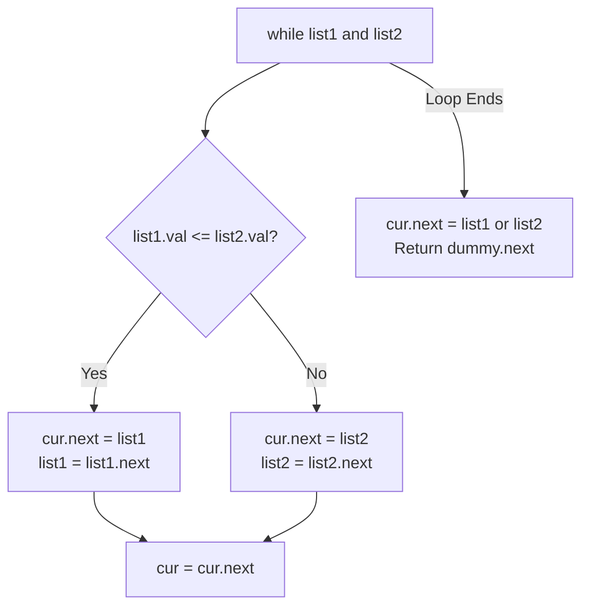

# LeetCode 21: Merge Two Sorted Lists

> **Pattern:** Two-list zipper merge with dummy node  
> **Difficulty:** Easy  
> **Link:** [LeetCode 21](https://leetcode.com/problems/merge-two-sorted-lists/)

## The problem

You are given the heads of two sorted linked lists `list1` and `list2`. Merge the two lists into one sorted list by splicing together the existing nodes, and return the head of the merged list.

```text
Input:  list1 = [1, 2, 4], list2 = [1, 3, 4]
Output: [1, 1, 2, 3, 4, 4]
```

## The core trick

You do not need to allocate new `ListNode` objects for every number. You just rewire `.next` pointers to zipper the existing nodes into a single sorted chain.

Use two pointers to build the merged chain:
- `dummy`: a fixed anchor node (`ListNode(0)`) at the start. It never moves, and it saves you from writing extra `if` checks to decide which list has the smaller initial head.
- `cur`: the tail pointer of the chain you are building. At each step, compare `list1.val` and `list2.val`, point `cur.next` at the smaller node, advance that list's pointer, and step `cur` onto the newly attached node.

When one list runs out of nodes, you do not need another loop. Since the remaining nodes in the other list are already sorted and connected, a single `cur.next = list1 or list2` attaches the entire leftover tail at once.



## Step-by-step trace

Merging `list1 = [1, 4]` and `list2 = [2, 3]`:

```text
Start:
  [dummy: 0] ──► None
       ▲
      cur

Round 1: Compare 1 vs 2 -> pick 1 from list1
  cur.next = list1; list1 = list1.next; cur = cur.next
  [dummy: 0] ──► [ 1 ]
                   ▲
                  cur    (list1 is at [4], list2 is at [2 -> 3])

Round 2: Compare 4 vs 2 -> pick 2 from list2
  cur.next = list2; list2 = list2.next; cur = cur.next
  [dummy: 0] ──► [ 1 ] ──► [ 2 ]
                             ▲
                            cur    (list1 is at [4], list2 is at [3])

Round 3: Compare 4 vs 3 -> pick 3 from list2
  cur.next = list2; list2 = list2.next; cur = cur.next
  [dummy: 0] ──► [ 1 ] ──► [ 2 ] ──► [ 3 ]
                                       ▲
                                      cur    (list1 is at [4], list2 is None)

Finish: list2 is None, so attach the rest of list1 in one step (cur.next = list1)
  [dummy: 0] ──► [ 1 ] ──► [ 2 ] ──► [ 3 ] ──► [ 4 ] ──► None
                   ▲
               dummy.next (returned head)
```

## Traps to watch for

- **Writing `cur.next = list1.val`:** `.val` is an integer, whereas `.next` expects a `ListNode` reference. Always assign the node itself (`cur.next = list1`).
- **Using `while list1 or list2:`:** If one list is `None`, checking `list1.val <= list2.val` raises an `AttributeError`. Loop with `while list1 and list2:`, then attach the non-empty remainder after the loop.
- **Returning `dummy` instead of `dummy.next`:** Includes the dummy node's `0` at the front of the output.

## Solution

<details>
<summary>Spoiler: Solution Code</summary>

```python
class Solution:
    def mergeTwoLists(self, list1: ListNode | None, list2: ListNode | None) -> ListNode | None:
        dummy = ListNode()
        cur = dummy

        while list1 and list2:
            if list1.val <= list2.val:
                cur.next = list1
                list1 = list1.next
            else:
                cur.next = list2
                list2 = list2.next
            cur = cur.next

        cur.next = list1 if list1 else list2
        return dummy.next
```

</details>

## Complexity

- **Time:** $\mathcal{O}(n + m)$ where $n$ and $m$ are the lengths of the two lists.
- **Space:** $\mathcal{O}(1)$ auxiliary space since we reuse the existing nodes.
