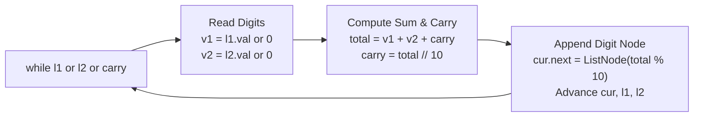

# LeetCode 2: Add Two Numbers

> **Pattern:** Linked list traversal with carry state  
> **Difficulty:** Medium  
> **Link:** [LeetCode 2](https://leetcode.com/problems/add-two-numbers/)

## The problem

You are given two non-empty linked lists representing two non-negative integers. The digits are stored in reverse order, and each node contains a single digit. Add the two numbers and return the sum as a reversed linked list.

```text
Input:  l1 = [2, 4, 3], l2 = [5, 6, 4]
Output: [7, 0, 8]
Explanation: 342 + 465 = 807.
```

## The core trick

When you add numbers by hand, you start at the ones place and work left, carrying any sum $\ge 10$ into the next column. Because these lists are already stored in reverse order, both heads start right at the ones place (`2` and `5`). You can walk both lists from head to tail and do elementary school addition in a single pass.

To build the output list cleanly, use two pointers:
- `dummy`: a fixed stake at the very front (`ListNode(0)`) that never moves.
- `cur`: a builder pointer that starts at `dummy`, attaches each new digit node (`cur.next = ListNode(val)`), and steps onto it (`cur = cur.next`).

If you only used `dummy` and moved it forward, you would lose the front of your result list. If you never moved `dummy` and kept writing `dummy.next = ListNode(val)`, you would overwrite the first node on every loop iteration.



## Step-by-step trace

### Standard addition (`[2, 4, 3] + [5, 6, 4]`)
1. Ones place: `2 + 5 + 0 (carry) = 7` -> digit `7`, `carry = 0`. Attach `[7]`.
2. Tens place: `4 + 6 + 0 (carry) = 10` -> digit `0`, `carry = 1`. Attach `[0]`.
3. Hundreds place: `3 + 4 + 1 (carry) = 8` -> digit `8`, `carry = 0`. Attach `[8]`.
4. Return `dummy.next`, which points to `7 -> 0 -> 8`.

```text
[ dummy ] ────► [ 7 ] ────► [ 0 ] ────► [ 8 ] ────► None
    ▲             ▲                       ▲
  stake      dummy.next                  cur
```

### Edge cases handled by one loop condition
Using `while l1 or l2 or carry:` handles mismatched lengths and leftover carries in the same block:
- **Different lengths (`[2, 4, 3] + [5, 6, 4, 9]`):** When `l1` hits `None`, substitute `0` for its digit (`v1 = l1.val if l1 else 0`) and keep walking `l2`.
- **Trailing carry (`[7] + [8]`):** After adding `7 + 8 = 15`, both `l1` and `l2` are `None`, but `carry = 1`. Keeping `or carry` in the `while` condition forces one last iteration to append `[1]`, giving `5 -> 1`.

## Traps to watch for

- **Forgetting `or carry` in the loop condition:** Drops the most significant digit whenever the final column sums to 10 or more (like `99 + 1 = 100`).
- **Advancing a pointer that is already `None`:** Always guard pointer steps with `l1 = l1.next if l1 else None`.
- **Returning `dummy` instead of `dummy.next`:** Includes the extra leading `0` from the dummy anchor in your answer.

## Solution

<details>
<summary>Spoiler: Solution Code</summary>

```python
class ListNode:
    def __init__(self, val=0, next=None):
        self.val = val
        self.next = next

class Solution:
    def addTwoNumbers(self, l1: ListNode | None, l2: ListNode | None) -> ListNode | None:
        dummy = ListNode()
        cur = dummy
        carry = 0

        while l1 or l2 or carry:
            v1 = l1.val if l1 else 0
            v2 = l2.val if l2 else 0

            total = v1 + v2 + carry
            carry = total // 10
            digit = total % 10

            cur.next = ListNode(digit)
            cur = cur.next

            l1 = l1.next if l1 else None
            l2 = l2.next if l2 else None

        return dummy.next
```

</details>

## Complexity

- **Time:** $\mathcal{O}(\max(n, m))$ where $n$ and $m$ are the lengths of the two lists.
- **Space:** $\mathcal{O}(\max(n, m))$ for the new nodes in the output list ($\mathcal{O}(1)$ auxiliary space beyond the output).
