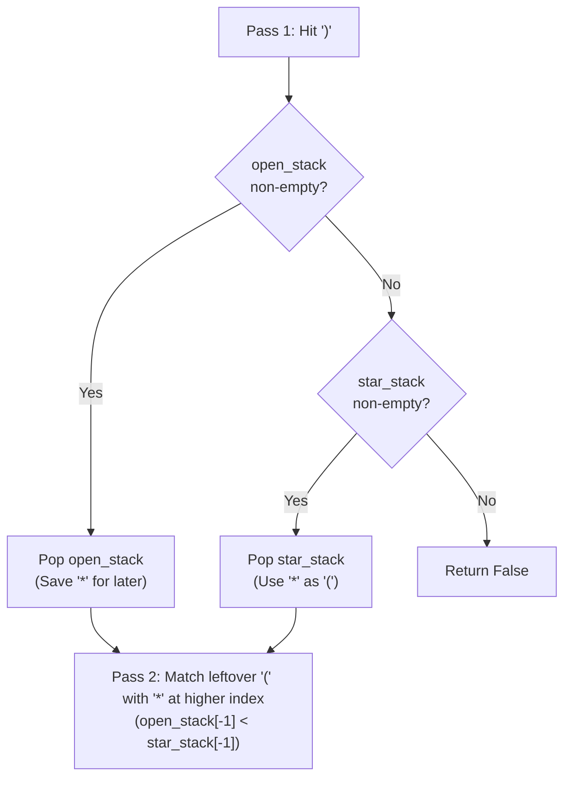

# LeetCode 678: Valid Parenthesis String

> **Pattern:** Two index stacks (or greedy open-count range)  
> **Difficulty:** Medium  
> **Link:** [LeetCode 678](https://leetcode.com/problems/valid-parenthesis-string/)

## The problem

Given a string `s` containing `'('`, `')'`, and `'*'`, return `True` if the string is valid. Every `'('` must be closed by a matching `')'` that comes after it, and each `'*'` can independently act as `'('`, `')'`, or an empty string `""`.

```text
s = "(*)"   -> True  ('*' acts as "")
s = "(*))"  -> True  ('*' acts as '(')
s = "*("    -> False ('*' comes before '(', so it cannot close it)
```

## Why the naive way fails

Trying `s.replace("*", ")")` or `s.replace("*", "(")` forces every `'*'` in the string to become the same character. In a string like `"(*))("` or `"(*(*)"`, one `'*'` might need to act as `'('`, another as `')'`, and another as `""`.

## The core trick

Keep two stacks that store **string indices** (not the characters themselves):
- `open_stack`: indices where `'('` appeared.
- `star_stack`: indices where `'*'` appeared.

We store indices because position matters at the end: a `'*'` at index `1` can close a `'('` at index `0`, but a `'*'` at index `0` can never close a `'('` at index `1` (`"*("`).

### Pass 1: Handle every `')'` as you scan left to right
When you hit `')'`:
1. Prefer matching it with a real `'('` (`open_stack.pop()`) if one is available, saving your flexible `'*'` wildcards for later.
2. If `open_stack` is empty, spend a `'*'` as an opening bracket (`star_stack.pop()`).
3. If both stacks are empty, this `')'` has nothing in front of it to match with, so return `False`.

### Pass 2: Close leftover `'('` using leftover `'*'`
After scanning the string, some `'('` may still sit in `open_stack`. Pop from both stacks together while checking their indices:
- If `open_stack[-1] < star_stack[-1]`, the star sits to the right of `'('`, so it can act as `')'` and close it. Pop both.
- If `open_stack[-1] > star_stack[-1]`, the rightmost star sits to the left of the rightmost `'('`. No remaining star can close this `'('`, so return `False`.

Any extra stars left after `open_stack` empties simply become `""`.



## Step-by-step trace

Trace on `s = "(*))"`:

```text
i = 0, ch = '(': open_stack = [0], star_stack = []
i = 1, ch = '*': open_stack = [0], star_stack = [1]
i = 2, ch = ')': pop from open_stack -> open_stack = [], star_stack = [1]
i = 3, ch = ')': open_stack is empty, so pop from star_stack -> star_stack = []

End of loop: open_stack is empty -> return True
```

## Traps to watch for

- **Pushing characters (`'('`) instead of indices (`i`):** Without indices, `s = "*("` leaves one `'('` and one `'*'` in your stacks and tricks you into returning `True` even though the star came before the open parenthesis.
- **Spending `star_stack` before `open_stack` on `')'`:** Always match `')'` with a real `'('` first. Stars can act as `')'` later, whereas `'('` can only ever be closed.

## Solution

<details>
<summary>Spoiler: Solution Code</summary>

```python
class Solution:
    def checkValidString(self, s: str) -> bool:
        open_stack = []
        star_stack = []

        for i, ch in enumerate(s):
            if ch == '(':
                open_stack.append(i)
            elif ch == '*':
                star_stack.append(i)
            else:
                if open_stack:
                    open_stack.pop()
                elif star_stack:
                    star_stack.pop()
                else:
                    return False

        while open_stack and star_stack:
            if open_stack[-1] < star_stack[-1]:
                open_stack.pop()
                star_stack.pop()
            else:
                return False

        return not open_stack
```

</details>

## Complexity

- **Time:** $\mathcal{O}(n)$ to scan the string once and pop at most $n$ items.
- **Space:** $\mathcal{O}(n)$ to store indices in `open_stack` and `star_stack`.
