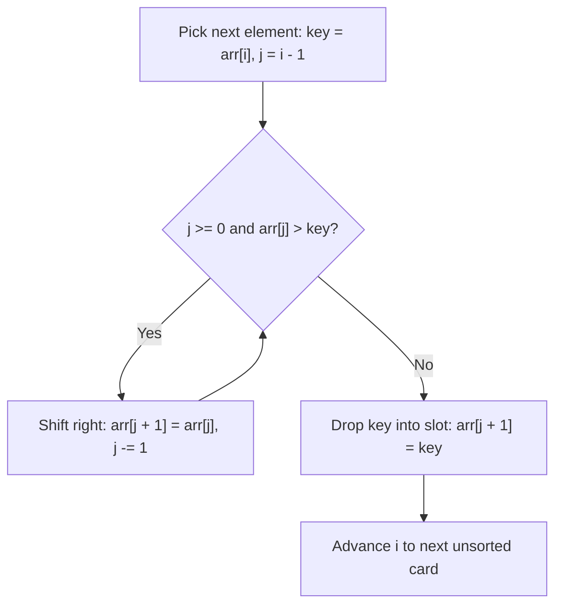

# Insertion sort

> **Source reference:** [AlgoMaster.io, Insertion Sort](https://algomaster.io/learn/dsa/insertion-sort)  
> **Category:** Comparison-based adaptive sorting  
> **Difficulty:** Easy

## 1. How insertion sort works

Insertion sort builds a sorted prefix one element at a time, similar to sorting playing cards in your hand:
1. Start with index 0 as a 1-element sorted prefix.
2. Pick the next element `key = arr[i]`.
3. Scan backward through the sorted prefix `arr[0...i-1]`, shifting any element larger than `key` one position to the right.
4. Drop `key` into the open slot.



## 2. Walkthrough

Array: `[12, 11, 13, 5, 6]`

1. **Step 1 ($i = 1$):** `key = 11`. Compare with `12`. Shift `12` right, insert `11`.  
   $\to [\mathbf{11, 12}, 13, 5, 6]$
2. **Step 2 ($i = 2$):** `key = 13`. Compare with `12`. Since $13 > 12$, no shift needed.  
   $\to [\mathbf{11, 12, 13}, 5, 6]$
3. **Step 3 ($i = 3$):** `key = 5`. Compare with `13, 12, 11`. Shift all three right, insert `5` at index 0.  
   $\to [\mathbf{5, 11, 12, 13}, 6]$
4. **Step 4 ($i = 4$):** `key = 6`. Shift `13, 12, 11` right, stop at `5`, insert `6` at index 1.  
   $\to [\mathbf{5, 6, 11, 12, 13}]$

## 3. Python 3 implementation

```python
def insertion_sort(arr: list[int]) -> list[int]:
    for i in range(1, len(arr)):
        key = arr[i]
        j = i - 1
        
        # Shift elements of arr[0...i-1] that are greater than key one position right
        while j >= 0 and arr[j] > key:
            arr[j + 1] = arr[j]
            j -= 1
            
        arr[j + 1] = key
        
    return arr
```

## 4. Complexity and characteristics

* **Best-case time:** $\mathcal{O}(n)$ when the array is already sorted (the inner `while` loop condition fails immediately on every step).
* **Average and worst-case time:** $\mathcal{O}(n^2)$ (worst case is a reverse-sorted array).
* **Space complexity:** $\mathcal{O}(1)$ in place.
* **Stability:** Stable, because the inner loop stops shifting when `arr[j] <= key`.
* **Production usage:** Hybrid sorting algorithms like Timsort (used in Python's `list.sort()` and Java's `Arrays.sort()`) switch to insertion sort for small subarrays ($N \le 32$ or $64$) because it has tiny constant overhead and sequential memory access.
