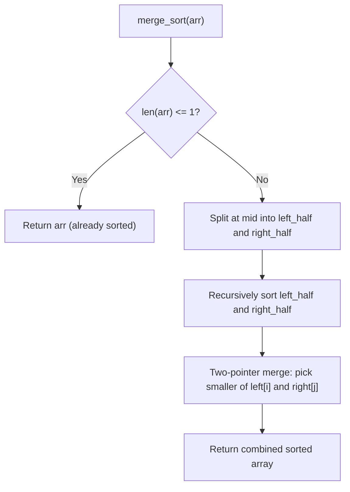

# Merge sort

> **Source reference:** [AlgoMaster.io, Merge Sort](https://algomaster.io/learn/dsa/merge-sort)  
> **Category:** Divide and conquer  
> **Difficulty:** Medium

## 1. How merge sort works

Merge sort uses divide and conquer:
1. **Divide:** Split the array at the midpoint recursively until each subarray has 1 element (a 1-element array is already sorted).
2. **Merge:** Combine pairs of sorted subarrays back into a single sorted array in linear time using two pointers.

```text
                  [38, 27, 43, 3, 9, 82, 10]
                  /                        \
          [38, 27, 43, 3]              [9, 82, 10]
          /             \              /         \
      [38, 27]       [43, 3]        [9, 82]      [10]
      /      \       /     \        /     \        |
    [38]    [27]   [43]    [3]     [9]    [82]   [10]
      \      /       \     /        \     /        |
      [27, 38]       [3, 43]        [9, 82]      [10]
          \             /              \         /
          [3, 27, 38, 43]              [9, 10, 82]
                  \                        /
                  [3, 9, 10, 27, 38, 43, 82]
```



## 2. Python 3 implementation

```python
def merge_sort(arr: list[int]) -> list[int]:
    if len(arr) <= 1:
        return arr
        
    mid = len(arr) // 2
    left_half = merge_sort(arr[:mid])
    right_half = merge_sort(arr[mid:])
    
    return merge(left_half, right_half)

def merge(left: list[int], right: list[int]) -> list[int]:
    result = []
    i = j = 0
    
    while i < len(left) and j < len(right):
        if left[i] <= right[j]:  # <= preserves stability
            result.append(left[i])
            i += 1
        else:
            result.append(right[j])
            j += 1
            
    result.extend(left[i:])
    result.extend(right[j:])
    return result
```

## 3. Complexity and characteristics

* **Time complexity:** $\mathcal{O}(n \log n)$ in best, average, and worst cases.
  * The recursion tree has $\lceil \log_2 n \rceil$ levels.
  * Merging across all subarrays at a given level does $\mathcal{O}(n)$ work.
* **Space complexity:** $\mathcal{O}(n)$ auxiliary memory for the merged subarrays (plus $\mathcal{O}(\log n)$ recursion stack).
* **Stability:** Stable, since ties favor `left[i]` (`left[i] <= right[j]`).
* **Where it fits best:** Sorting linked lists (where pointer manipulation merges nodes in $\mathcal{O}(1)$ extra space without random access) and external merge sort on disk datasets larger than RAM.
