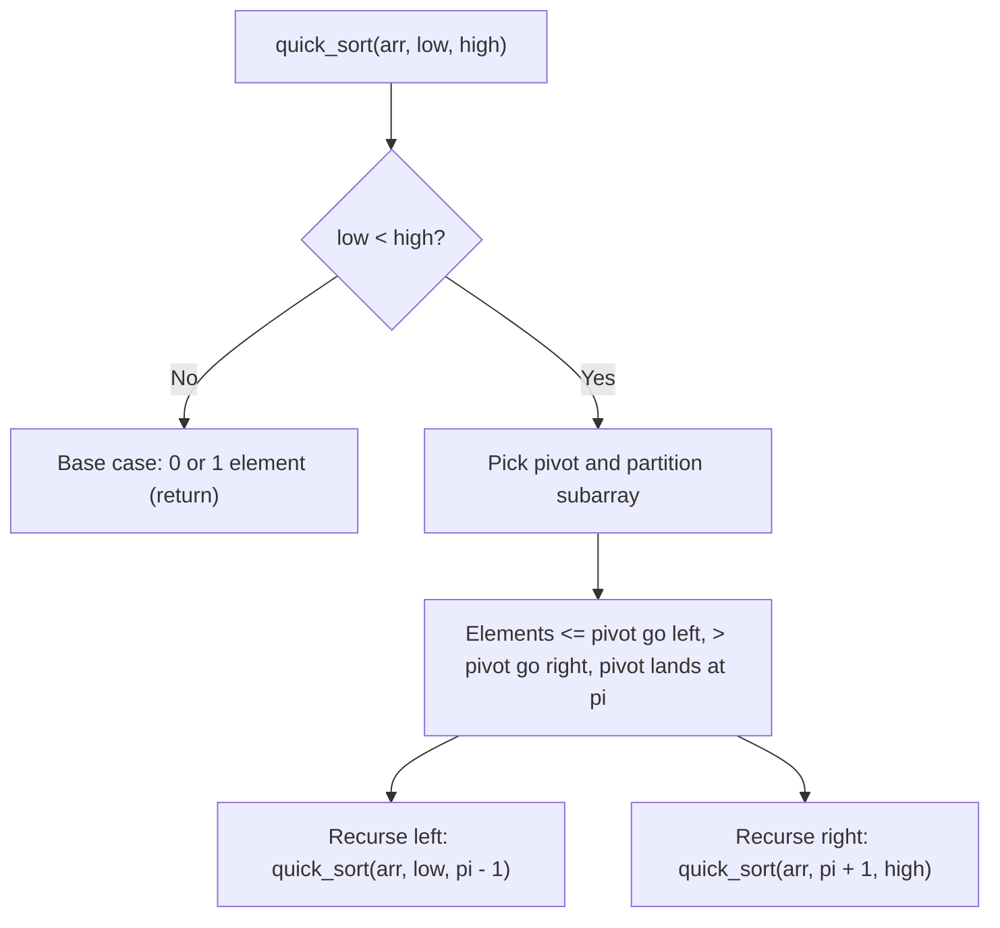

# Quick sort

> **Source reference:** [AlgoMaster.io, Quick Sort](https://algomaster.io/learn/dsa/quick-sort)  
> **Category:** Divide and conquer (partitioning)  
> **Difficulty:** Medium

## 1. How quick sort works

Quick sort is an in-place divide-and-conquer sorting algorithm:
1. **Pick a pivot:** Choose an element from the subarray (for example, the last element, a random element, or the median of three).
2. **Partition:** Rearrange the subarray so that:
   * Elements $\le$ the pivot sit to its left.
   * Elements $>$ the pivot sit to its right.
   * The pivot lands at its final sorted index `pi`.
3. **Recurse:** Run quick sort on the left subarray `low...pi-1` and the right subarray `pi+1...high`.



## 2. Lomuto partition trace

Array: `[10, 80, 30, 90, 40, 50, 70]`, pivot = `70` (last element)
* Pointer `i` tracks the end of the region containing elements $\le 70$ (starts at `low - 1`).
* Pointer `j` scans from `low` to `high - 1`:
  * `10 <= 70`: increment `i`, swap `arr[i]` with `arr[j]`.
  * `80 > 70`: skip.
  * `30 <= 70`: increment `i`, swap `80` and `30`.
  * Continue until `j` reaches `high - 1`, then swap the pivot `70` into `arr[i + 1]`.

## 3. Python 3 implementation

```python
def quick_sort(arr: list[int], low: int, high: int) -> None:
    if low < high:
        pi = partition(arr, low, high)
        
        quick_sort(arr, low, pi - 1)   # Sort left of pivot
        quick_sort(arr, pi + 1, high)  # Sort right of pivot

def partition(arr: list[int], low: int, high: int) -> int:
    pivot = arr[high]
    i = low - 1
    
    for j in range(low, high):
        if arr[j] <= pivot:
            i += 1
            arr[i], arr[j] = arr[j], arr[i]
            
    arr[i + 1], arr[high] = arr[high], arr[i + 1]
    return i + 1
```

## 4. Complexity and characteristics

* **Average-case time:** $\mathcal{O}(n \log n)$ with low constant overhead and good cache locality.
* **Worst-case time:** $\mathcal{O}(n^2)$, which happens when the chosen pivot is repeatedly the smallest or largest element (such as picking the last element on an already-sorted array). Randomized pivot selection or median-of-three avoids this on sorted inputs.
* **Space complexity:** $\mathcal{O}(\log n)$ expected recursion stack depth ($\mathcal{O}(n)$ in the skewed worst case).
* **Stability:** Unstable, because partitioning swaps non-adjacent elements across the array.
