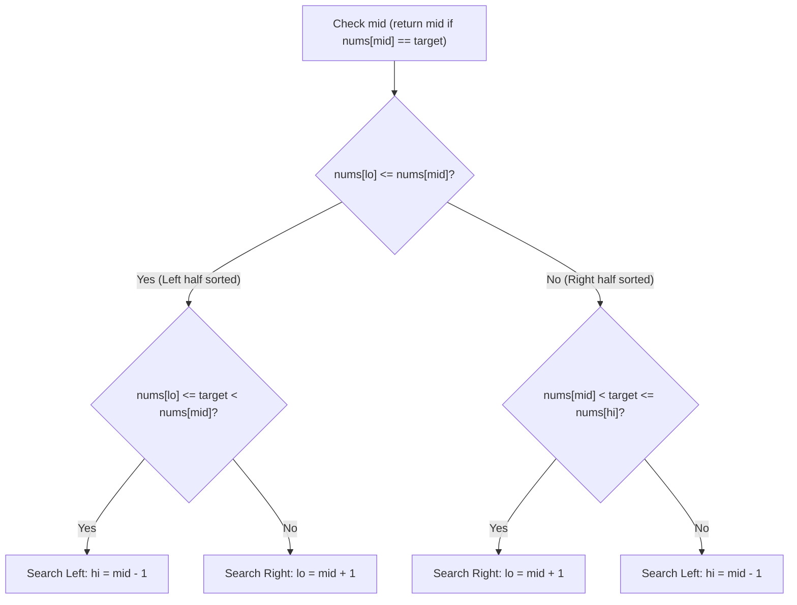

# Search in rotated sorted array (half-identification pattern)

> **Course reference:** CodeKerdos DSA, Classes 9 and 10  
> **Core concept:** Solving LeetCode 33 and 153 in $\mathcal{O}(\log N)$ time by identifying which half is sorted at each step.

## 1. Problem statement

An ascending sorted array of distinct integers `nums` is rotated at an unknown pivot index:
```text
Original: [ 0 , 1 , 2 , 4 , 5 , 6 , 7 ]
Rotated:  [ 4 , 5 , 6 , 7 , 0 , 1 , 2 ]
Target: 0 -> Returns index 4
```

## 2. The half-identification invariant

When a sorted array is rotated once, splitting it at any midpoint `mid` guarantees that **at least one of the two halves (`[lo..mid]` or `[mid..hi]`) is strictly sorted**.

Comparing `nums[lo]` against `nums[mid]` tells you which half has no rotation cliff:

```text
nums = [ 4 , 5 , 6 , 7 , 0 , 1 , 2 ]
         ▲           ▲           ▲
        lo          mid         hi

Compare nums[lo] (4) and nums[mid] (7):
Since nums[lo] <= nums[mid] (4 <= 7), the left half [4, 5, 6, 7] is sorted.
```

### Steering rules
1. **Left half is sorted (`nums[lo] <= nums[mid]`):**
   * Check whether `target` sits inside the sorted left range:
     $$\text{nums}[lo] \le \text{target} < \text{nums}[mid]$$
   * If yes, search left: `hi = mid - 1`.
   * Otherwise, search right: `lo = mid + 1`.

2. **Right half is sorted (`nums[mid] < nums[hi]`):**
   * Check whether `target` sits inside the sorted right range:
     $$\text{nums}[mid] < \text{target} \le \text{nums}[hi]$$
   * If yes, search right: `lo = mid + 1`.
   * Otherwise, search left: `hi = mid - 1`.



## 3. Implementation (LeetCode 33)

```python
def search(nums: list[int], target: int) -> int:
    lo, hi = 0, len(nums) - 1

    while lo <= hi:
        mid = lo + (hi - lo) // 2

        if nums[mid] == target:
            return mid

        # Left half is sorted
        if nums[lo] <= nums[mid]:
            if nums[lo] <= target < nums[mid]:
                hi = mid - 1
            else:
                lo = mid + 1
        # Right half is sorted
        else:
            if nums[mid] < target <= nums[hi]:
                lo = mid + 1
            else:
                hi = mid - 1

    return -1
```

## 4. Finding the minimum in a rotated sorted array (LeetCode 153)

To locate the minimum element (the rotation pivot), compare `nums[mid]` against `nums[hi]`:

```python
def findMin(nums: list[int]) -> int:
    lo, hi = 0, len(nums) - 1

    while lo < hi:
        mid = lo + (hi - lo) // 2

        if nums[mid] > nums[hi]:
            # Minimum sits to the right of mid, past the rotation drop
            lo = mid + 1
        else:
            # mid could be the minimum itself, so keep mid in the range
            hi = mid

    return nums[lo]
```

* **Time complexity:** $\mathcal{O}(\log N)$.
* **Auxiliary space:** $\mathcal{O}(1)$.
