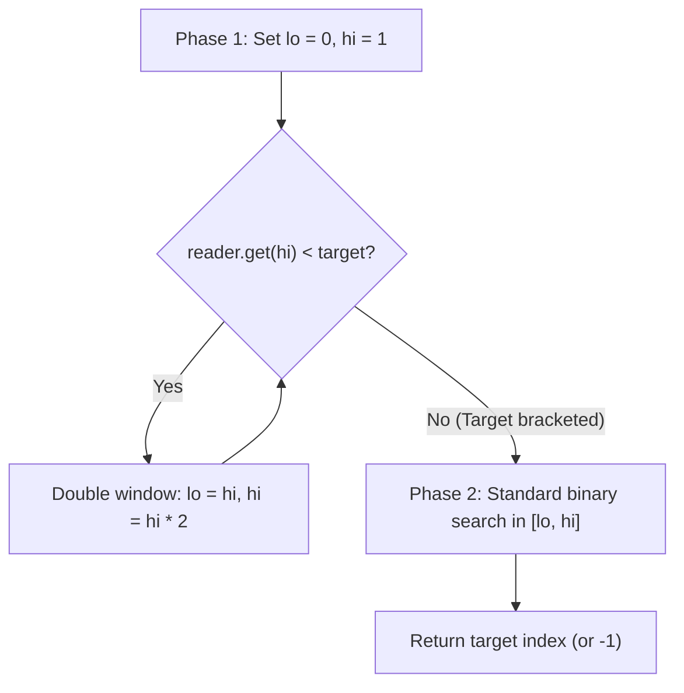

# Exponential search in infinite or unbounded arrays

> **Course reference:** CodeKerdos DSA, Class 10  
> **Core concept:** Solving LeetCode 702 in $\mathcal{O}(\log P)$ time using exponential window doubling followed by binary search.

## 1. Problem statement

Given a sorted array of unknown or infinite length where `len(arr)` is unavailable (and out-of-bounds reads return $\infty$ or $2^{31}-1$), find the index of target $K$.

```text
arr = [ 1 , 3 , 5 , 7 , 9 , 11 , 13 , 15 , 17 , 19 , ... ∞ ]
Constraint: len(arr) is unknown.
Target: 13
```

## 2. Two-phase algorithm: exponential doubling + binary search

A linear scan (`while arr[i] < k: i += 1`) takes $\mathcal{O}(P)$ time, where $P$ is the target's index. If $P = 10^9$, a linear scan times out.

### Phase 1: Exponential doubling ($\mathcal{O}(\log P)$)
Since you cannot initialize `hi = len(arr) - 1`, find an upper bound by doubling `hi`:
1. Start with `lo = 0` and `hi = 1`.
2. While `arr[hi] < k`:
   * Set `lo = hi`.
   * Double `hi = hi * 2`.

```text
Target k = 13:

Step 0: lo = 0, hi = 1   -> arr[1] = 3   < 13 -> double
Step 1: lo = 1, hi = 2   -> arr[2] = 5   < 13 -> double
Step 2: lo = 2, hi = 4   -> arr[4] = 9   < 13 -> double
Step 3: lo = 4, hi = 8   -> arr[8] = 17 >= 13 -> stop
        Search range [lo, hi] = [4, 8]
```

### Phase 2: Binary search inside $[lo, hi]$ ($\mathcal{O}(\log P)$)
Once `arr[lo] < k <= arr[hi]`, run standard binary search on `[lo, hi]`.



## 3. Implementation (LeetCode 702)

```python
class ArrayReader:
    def get(self, index: int) -> int:
        """Returns arr[index], or 2**31 - 1 if index is out of bounds."""
        pass

def search_infinite(reader: 'ArrayReader', target: int) -> int:
    # Phase 1: Exponential doubling to bracket the target
    lo = 0
    hi = 1
    while reader.get(hi) < target:
        lo = hi
        hi *= 2

    # Phase 2: Binary search in [lo, hi]
    while lo <= hi:
        mid = lo + (hi - lo) // 2
        val = reader.get(mid)
        if val == target:
            return mid
        elif val < target:
            lo = mid + 1
        else:
            hi = mid - 1

    return -1
```

## 4. Complexity derivation

Let $P$ be the index of the target:
1. **Doubling phase:** `hi` takes values $1, 2, 4, 8, \dots, 2^m$ and stops as soon as $2^m \ge P$, which takes $m = \lceil\log_2 P\rceil$ steps.
2. **Binary search phase:** The bracketed window has size $hi - lo \le 2P - P = P$, so binary search takes at most $\log_2 P$ steps.

$$\text{Total time} = \mathcal{O}(\log P) + \mathcal{O}(\log P) = \mathcal{O}(\log P)$$
* **Auxiliary space:** $\mathcal{O}(1)$.
