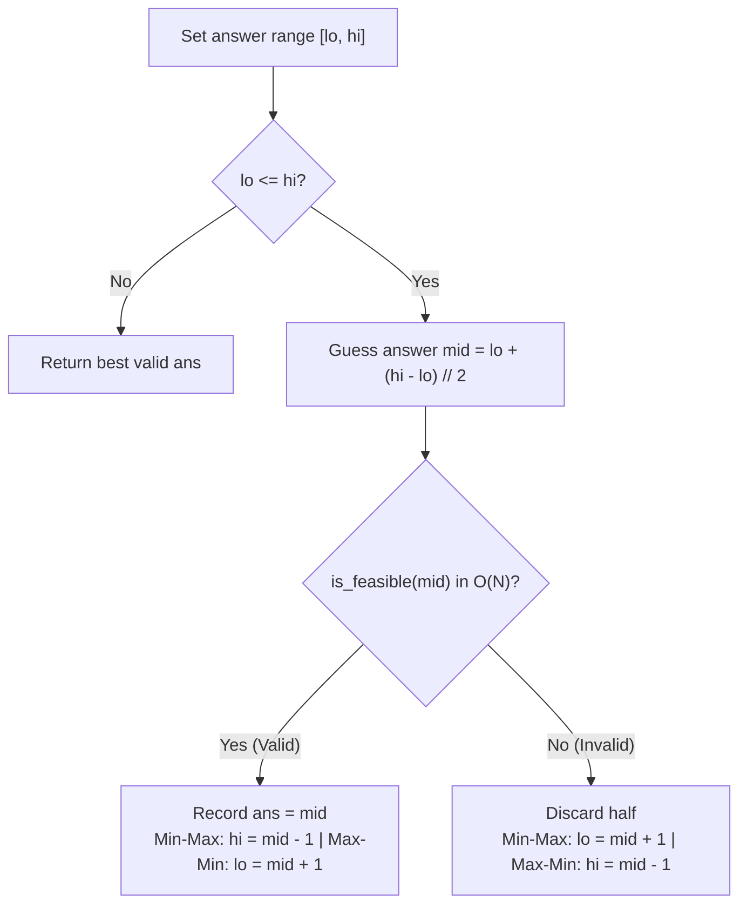

# Binary search on the answer (greedy predicates)

> **Course reference:** CodeKerdos DSA, Classes 9 and 10  
> **Core concept:** Solving min-max and max-min optimization problems by binary searching over candidate answers and validating each guess in $\mathcal{O}(N)$ (Painter's Partition, Aggressive Cows, Allocate Books, LC 875, LC 410, LC 1552).

## 1. What binary search on the answer means

Instead of searching for an index in the input array, you binary search over the range of possible answers $[lo, hi]$.

### How to spot this pattern
1. The prompt asks for the **minimum of a maximum** (for example, minimize the maximum pages/board length assigned to any worker) or the **maximum of a minimum** (for example, maximize the minimum distance between any two cows).
2. A greedy feasibility check `is_feasible(x)` is monotonic across the answer range:
   ```text
   Capacity:    1     2     3     4     5     6     7
   Feasible?  [ No ,  No ,  No ,  YES,  YES,  YES,  YES ]
                                   ▲
                          First valid capacity = 4
   ```
3. If capacity $4$ is enough to finish the job, every capacity $> 4$ also works.
4. If capacity $3$ is too small, every capacity $< 3$ also fails.

## 2. Three-step template

1. **Set the answer bounds $[lo, hi]$:**
   * For partitioning arrays into contiguous chunks: `lo = max(arr)` (one chunk must hold the single largest item) and `hi = sum(arr)` (one chunk holds the entire array).
2. **Write the $\mathcal{O}(N)$ greedy check `is_feasible(mid)`:**
   * Greedily pack items from left to right without exceeding `mid`, counting how many chunks or items you can place.
3. **Run binary search on $[lo, hi]$:**
   * When minimizing a maximum: if `is_feasible(mid)` is `True`, record `ans = mid` and search left (`hi = mid - 1`) for an even smaller valid capacity. Otherwise, search right (`lo = mid + 1`).



## 3. Minimizing a maximum: Painter's Partition / Split Array Largest Sum (LC 410)

Given $N$ boards of length `nums[i]` and $k$ painters, find the minimum possible value of the largest board sum assigned to any painter, where each painter takes a contiguous slice.

```python
def splitArray(nums: list[int], k: int) -> int:
    def is_feasible(max_capacity: int) -> bool:
        chunks = 1
        current_sum = 0
        for num in nums:
            if current_sum + num > max_capacity:
                chunks += 1
                current_sum = num
            else:
                current_sum += num
        return chunks <= k

    lo = max(nums)
    hi = sum(nums)
    ans = hi

    while lo <= hi:
        mid = lo + (hi - lo) // 2
        if is_feasible(mid):
            ans = mid
            hi = mid - 1  # Try a smaller maximum workload
        else:
            lo = mid + 1  # Capacity too small; increase lower bound

    return ans
```

## 4. Maximizing a minimum: Aggressive Cows / Magnetic Force Between Two Balls (LC 1552)

Place `cows` cows into `stalls` at given coordinates so that the minimum distance between any two cows is as large as possible.

* **Monotonicity:** If we can space cows at least $D$ apart, any required distance $< D$ is also achievable.
* **Search bounds:** `lo = 1`, `hi = stalls[-1] - stalls[0]` (after sorting `stalls`).

```python
def maxDistance(stalls: list[int], cows: int) -> int:
    stalls.sort()

    def can_place(min_dist: int) -> bool:
        placed = 1
        last_pos = stalls[0]
        for i in range(1, len(stalls)):
            if stalls[i] - last_pos >= min_dist:
                placed += 1
                last_pos = stalls[i]
        return placed >= cows

    lo = 1
    hi = stalls[-1] - stalls[0]
    best_dist = 0

    while lo <= hi:
        mid = lo + (hi - lo) // 2
        if can_place(mid):
            best_dist = mid
            lo = mid + 1  # Try a larger minimum distance
        else:
            hi = mid - 1

    return best_dist
```

* **Time complexity:** $\mathcal{O}(N \log(\sum \text{nums} - \max(\text{nums})))$ for array splitting; $\mathcal{O}(N \log N + N \log(\text{max\_coord} - \text{min\_coord}))$ for Aggressive Cows.
* **Auxiliary space:** $\mathcal{O}(1)$.
