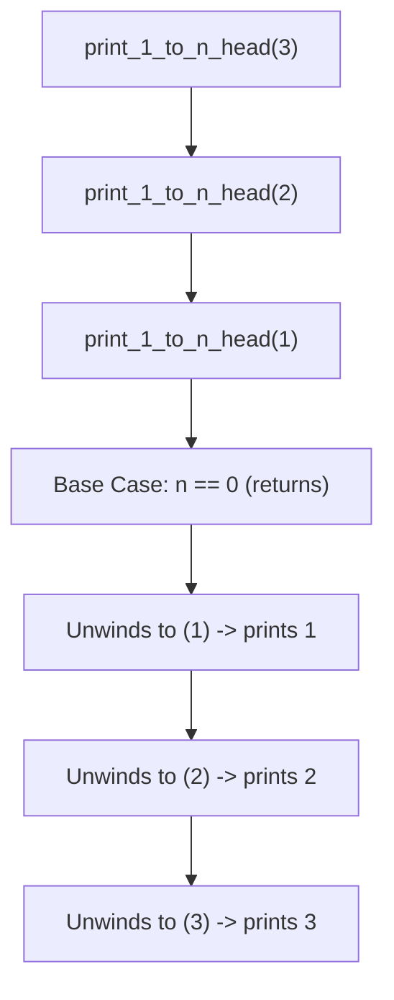
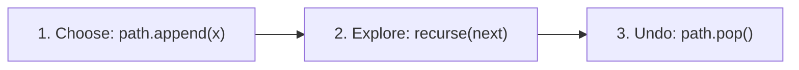

# Recursion Fundamentals and Call Stack Anatomy

> **Category:** Algorithmic Foundations | **Pattern:** Call Stack Mechanics  
> Sourced from: InterviewCoach DSA Python Cohort, FAANG Prep

## The mental model

Recursion is not magic. It is simply a function creating a new stack frame in computer memory, pausing its own execution, and waiting for the called frame to return a value.

```text
Call Stack Execution:
+----------------------------+
| print_1_to_n(1): paused   | <-- Top of call stack
+----------------------------+
| print_1_to_n(2): paused   |
+----------------------------+
| print_1_to_n(3): paused   |
+----------------------------+
| main(): paused             |
+----------------------------+
```

Every recursive algorithm requires two components:
1. **Base Case:** The condition where recursion stops without making another call. Without this, recursion continues until memory is exhausted (`RecursionError: maximum recursion depth exceeded`).
2. **Recursive Step:** Breaking the problem into a strictly smaller input that moves closer to the base case.

---

## Head vs. Tail Recursion

The timing of your operations relative to the recursive call completely changes execution order:

### 1. Tail Recursion (Work on the way DOWN)
You perform operations **before** making the recursive call.

```python
def print_1_to_n_tail(current: int, n: int) -> None:
    if current > n:
        return
    print(current)                      # Work done before calling next
    print_1_to_n_tail(current + 1, n)
```

### 2. Head Recursion (Work on the way UP)
You call recursively first, and perform operations **after** the recursive frame returns (during stack unwinding).

```python
def print_1_to_n_head(n: int) -> None:
    if n == 0:
        return
    print_1_to_n_head(n - 1)           # Dive deep first
    print(n)                           # Work done during unwinding
```



---

## Backtracking vs. Pure Recursion

Pure recursion returns values up the call stack (e.g., `return 1 + count_nodes(node.left)`).

**Backtracking** is recursion with **mutable state**. You pass a list or set down the call stack, modify it, recurse, and then **revert the modification** (`pop()` or `remove()`) before exploring sibling branches:

```text
        []
      /    \
   pick 1   skip 1
    /          \
  [1]          []
```



---

## Complexity rules for recursion

1. **Time Complexity:** Total number of recursive calls $\times$ work done per call.
   - Single branch dividing by 2: $\mathcal{O}(\log n)$ (Binary Search).
   - Linear reduction by 1: $\mathcal{O}(n)$ (Factorial, traversal).
   - Binary decision tree: $\mathcal{O}(2^n)$ (Subsets, combination sum).
   - Permutation tree: $\mathcal{O}(n!)$ (Permutations, N-Queens).
2. **Space Complexity:** Maximum height of the call stack at any one moment (depth of deepest leaf node).
