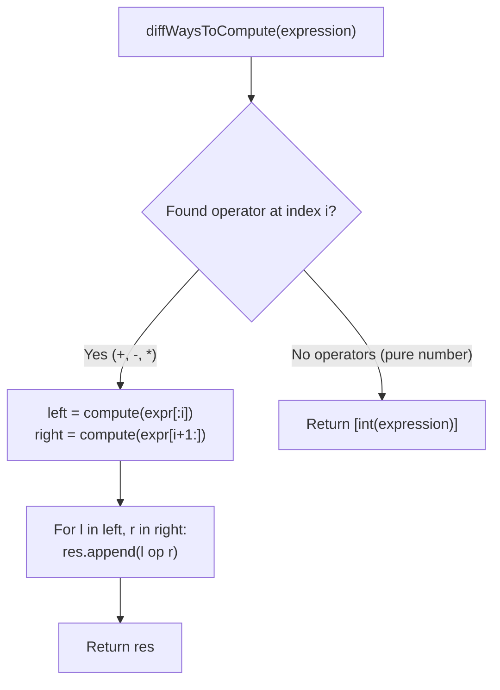

# LeetCode 241: Different Ways to Add Parentheses

> **Difficulty:** Medium | **Pattern:** Divide and Conquer / Expression Partitioning  
> **Source Code:** [`241_different_ways_to_add_parentheses.py`](./241_different_ways_to_add_parentheses.py)

## The problem

Given a string `expression` of numbers and operators (`+`, `-`, `*`), return all possible integer results obtained by grouping numbers and operators with parentheses in different valid orders.

## Why the naive way fails

Attempting to physically insert parentheses strings and evaluate them with `eval()` causes immense string manipulation bugs, duplicate evaluations, and slow parsing.

## The core trick

Every way to parenthesize an expression corresponds to choosing which operator executes **last**.
1. Iterate through `expression` character by character.
2. Whenever you see an operator `ch` (`+`, `-`, `*`) at index `i`:
   - Treat `ch` as the root of an expression tree.
   - Recursively compute all possible outcomes of the left sub-expression: `compute(expression[:i])`.
   - Recursively compute all possible outcomes of the right sub-expression: `compute(expression[i + 1:])`.
   - Combine every left value `l` with every right value `r` using the operator `ch`.
3. If no operators were found in the string, it is a single number: return `[int(expression)]`.

```text
Expression: "2 - 1 - 1"
Split at first '-':
  Left: "2"       --> [2]
  Right: "1 - 1"  --> [0]
  Combine: 2 - 0 = 2

Split at second '-':
  Left: "2 - 1"   --> [1]
  Right: "1"      --> [1]
  Combine: 1 - 1 = 0
```



<details>
<summary>Spoiler: Solution Code</summary>

```python
class Solution:
    def diffWaysToCompute(self, expression: str) -> list[int]:
        memo = {}

        def compute(expr: str) -> list[int]:
            if expr in memo:
                return memo[expr]

            res = []
            for i, ch in enumerate(expr):
                if ch in "+-*":
                    left = compute(expr[:i])
                    right = compute(expr[i + 1:])

                    for l in left:
                        for r in right:
                            if ch == "+":
                                res.append(l + r)
                            elif ch == "-":
                                res.append(l - r)
                            elif ch == "*":
                                res.append(l * r)

            if not res:
                res.append(int(expr))

            memo[expr] = res
            return res

        return compute(expression)
```

</details>

## Traps to watch for

- **Omitting memoization:** Sub-expressions like `"1-1"` or `"2*3"` appear in multiple branches of the recursion tree. Wrapping `compute` with a memo dictionary or `@lru_cache` prevents redundant work.
- **Handling multi-digit numbers:** When base case triggers, convert the full slice with `int(expr)` rather than reading single character digits.

## Complexity

- **Time Complexity:** Proportional to the $n$-th Catalan number $C_n = \frac{1}{n+1}\binom{2n}{n} \approx \mathcal{O}(4^n / n^{3/2})$.
- **Space Complexity:** $\mathcal{O}(C_n)$ to store intermediate combinations in the memoization table.
