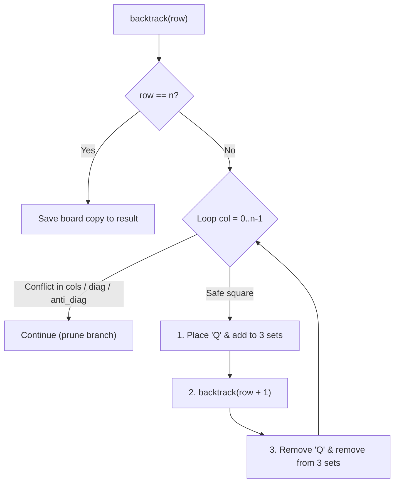

# LeetCode 51: N-Queens

> **Difficulty:** Hard | **Pattern:** Backtracking / Diagonal Set Hashing  
> **Source Code:** [`51_n_queens.py`](./51_n_queens.py)

## The problem

Place $n$ queens on an $n \times n$ chessboard such that no two queens attack each other. A queen attacks any piece on the same row, column, or diagonal. Return all distinct board configurations.

## Why the naive way fails

Testing all possible board configurations requires placing $n$ queens across $n^2$ squares ($\approx \binom{n^2}{n}$ combinations, which for $n=8$ is $4.4 \times 10^9$ possibilities). Furthermore, iterating across the board to check if each queen placement is valid takes $\mathcal{O}(n)$ time per check.

## The core trick

Place exactly one queen per row, which guarantees that no two queens share a row. For columns and diagonals, use **three hash sets** that provide $\mathcal{O}(1)$ conflict checks:
1. `cols`: Set of taken column indices `col`.
2. `diag`: Main diagonal constant `row - col`. Every square along a $\searrow$ diagonal has the exact same difference `r - c`.
3. `anti_diag`: Anti-diagonal constant `row + col`. Every square along a $\nearrow$ diagonal has the exact same sum `r + c`.

```text
Board Coordinates:
(0,0) (0,1) (0,2)     Main Diagonals (r - c):   0  -1  -2
(1,0) (1,1) (1,2)                               1   0  -1
(2,0) (2,1) (2,2)                               2   1   0
```



<details>
<summary>Spoiler: Solution Code</summary>

```python
class Solution:
    def solveNQueens(self, n: int) -> list[list[str]]:
        res = []
        board = [["."] * n for _ in range(n)]

        cols = set()
        diag = set()
        anti_diag = set()

        def backtrack(row: int) -> None:
            if row == n:
                res.append(["".join(r) for r in board])
                return

            for col in range(n):
                if col in cols or (row - col) in diag or (row + col) in anti_diag:
                    continue

                board[row][col] = "Q"
                cols.add(col)
                diag.add(row - col)
                anti_diag.add(row + col)

                backtrack(row + 1)

                board[row][col] = "."
                cols.remove(col)
                diag.remove(row - col)
                anti_diag.remove(row + col)

        backtrack(0)
        return res
```

</details>

## Traps to watch for

- **Mutating strings instead of list of lists:** Strings in Python are immutable. Build the board with lists of characters `[["."] * n for _ in range(n)]`, mutate in-place, and join with `"".join(row)` only when recording a finished solution at `row == n`.
- **Missing backtracks:** Every state added to `cols`, `diag`, or `anti_diag` must be removed after the recursive call returns.

## Complexity

- **Time Complexity:** $\mathcal{O}(n!)$ search space pruned heavily by the diagonal sets.
- **Space Complexity:** $\mathcal{O}(n)$ auxiliary sets and recursion stack depth.
