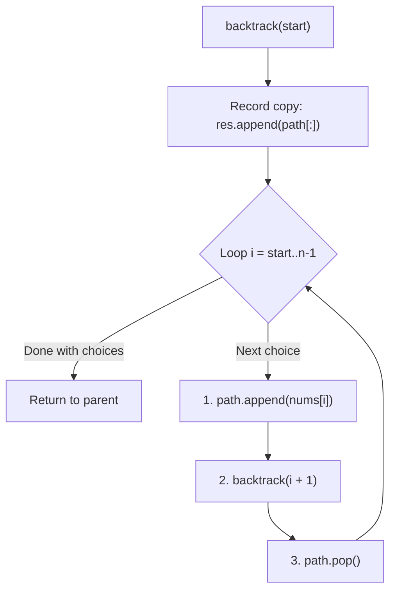

# LeetCode 78: Subsets

> **Difficulty:** Medium | **Pattern:** Backtracking / Power Set Generation  
> **Source Code:** [`78_subsets.py`](./78_subsets.py)

## The problem

Given an integer array `nums` of unique elements, return all possible subsets (the power set). The solution set must not contain duplicate subsets.

## Why the naive way fails

A set of size $n$ has exactly $2^n$ subsets. Attempting to generate them with fixed nested loops only works for a constant size $k$ (e.g., 3 loops for triples). To handle arbitrary $n$, you must use recursion or bit manipulation.

## The core trick

At each step, make choices using one of two mental models:

### Model 1: Start Index Loop (Pruning Earlier Elements)
Loop `i` from `start` to `len(nums) - 1`. Because order does not matter (`[1, 2]` is the same subset as `[2, 1]`), passing `i + 1` into the recursive call ensures elements to the left are never considered again. Every node in this decision tree is a valid subset, so append `path[:]` immediately upon entering the function.

```text
Decision Tree for [1, 2, 3]:
                     []
          /          |          \
        [1]         [2]         [3]
       /   \         |
    [1,2] [1,3]    [2,3]
     /
  [1,2,3]
```



<details>
<summary>Spoiler: Solution Code</summary>

```python
class Solution:
    def subsets(self, nums: list[int]) -> list[list[int]]:
        res, path = [], []

        def backtrack(start: int) -> None:
            res.append(path[:])  # Always append a copy!

            for i in range(start, len(nums)):
                path.append(nums[i])
                backtrack(i + 1)
                path.pop()

        backtrack(0)
        return res
```

</details>

## Traps to watch for

- **Appending without copying (`res.append(path)`):** Appending `path` directly stores a reference to the mutable list, which empties out as recursion unwinds, leaving `res` full of empty lists `[[], [], []]`. Always write `res.append(path[:])`.
- **Passing `start + 1` instead of `i + 1`:** Passing `start + 1` creates infinite loops or duplicates. The recursive call must use `i + 1` to advance past the current chosen index.

## Complexity

- **Time Complexity:** $\mathcal{O}(n \cdot 2^n)$ total (there are $2^n$ subsets, and copying each takes up to $\mathcal{O}(n)$ time).
- **Space Complexity:** $\mathcal{O}(n)$ auxiliary recursion stack space.
