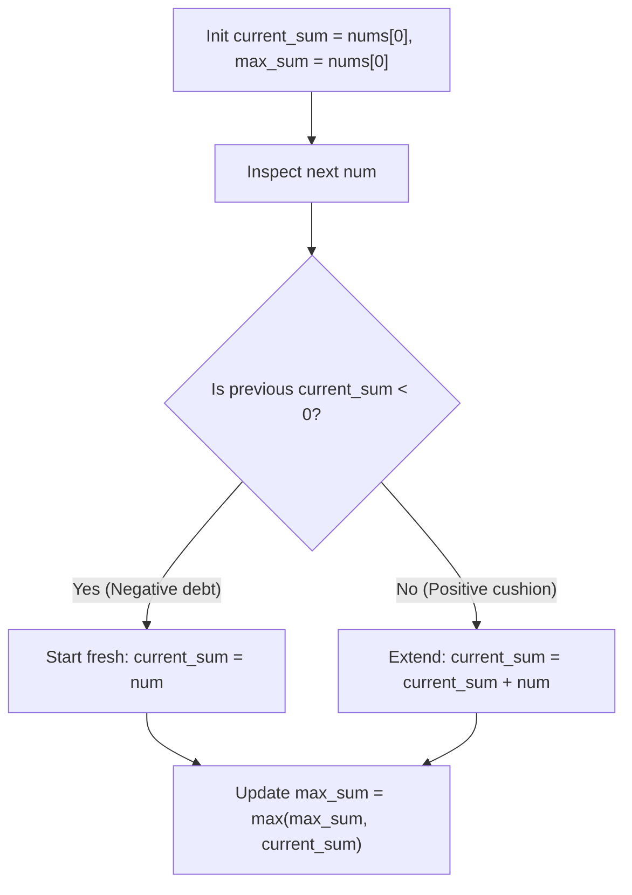

# Kadane's Algorithm Cheat Sheet

> Problem walkthrough: [LC 53: Maximum Subarray](../01_arrays_and_pointers/53_maximum_subarray.md)

Find the contiguous subarray with the largest sum in $\mathcal{O}(n)$ time and $\mathcal{O}(1)$ space.

## 1. When to use it
You have:
1. A **contiguous subarray** problem.
2. **Negative numbers** (penalties/losses mixed with gains).
3. A goal of **maximizing** (or minimizing) the total sum.

*(If all numbers were positive, the answer would just be the entire array. Negative numbers are the only reason this problem exists.)*

---

## 2. The Core Rule: Never Carry Negative Debt
As you walk left to right, maintain `current_sum`:
- If `current_sum` is **positive**, keep carrying it forward into the next number, even if it just took a small dip.
- The moment `current_sum` drops **below 0**, it drags down whatever comes next. Throw it away and start a fresh subarray at the current element.

At every element `num`:
$$\text{current\_sum} = \max(\text{num}, \text{current\_sum} + \text{num})$$
$$\text{max\_sum} = \max(\text{max\_sum}, \text{current\_sum})$$



---

## 3. Why other patterns fail here
- **Two Pointers:** Requires a sorted array so moving `left` or `right` changes the sum predictably. Sorting destroys subarray contiguity.
- **Sliding Window:** Shrinks `left` one step at a time. When `current_sum < 0`, you don't shrink one element at a time; you drop the entire prefix at once.

---

## 4. Standard Template

```python
class Solution:
    def maxSubArray(self, nums: list[int]) -> int:
        current_sum = nums[0]
        max_sum = nums[0]

        for num in nums[1:]:
            current_sum = max(num, current_sum + num)
            max_sum = max(max_sum, current_sum)

        return max_sum
```

### Trace on `[-2, 1, -3, 4, -1, 2, 1, -5, 4]`
| `num` | `current_sum + num` | `num` (fresh) | `current_sum` | `max_sum` | Why |
| :--- | :--- | :--- | :--- | :--- | :--- |
| `-2` | - | `-2` | `-2` | `-2` | Init at `nums[0]` |
| `1` | `-1` | `1` | `1` | `1` | Dropped `-2` debt |
| `-3` | `-2` | `-3` | `-2` | `1` | Dipped negative |
| `4` | `2` | `4` | `4` | `4` | Dropped `-2` debt |
| `-1` | `3` | `-1` | `3` | `4` | Still positive (`+3`), keep going |
| `2` | `5` | `2` | `5` | `5` | `+3` cushion pays off |
| `1` | `6` | `1` | `6` | `6` | Best subarray `[4, -1, 2, 1]` |

---

## 5. Traps & Variations
- **All-negative arrays (`[-5, -2, -8]`):** Never initialize `max_sum = 0`, or you'll return `0` (an empty subarray) instead of `-2`. Always start both variables at `nums[0]`.
- **Stock Profit ([LC 121](../01_arrays_and_pointers/121_best_time_to_buy_and_sell_stock.md)):** Tracking `min_price` is equivalent to running Kadane's on the daily price differences `prices[i] - prices[i-1]`.
- **Circular Array (LC 918):** Either the max subarray sits in the middle (normal Kadane), or it wraps around both ends (`total_sum - min_subarray_kadane`).
- **Max Product Subarray (LC 152):** Because a negative times a negative becomes positive, track both `cur_max` and `cur_min` at each step.
