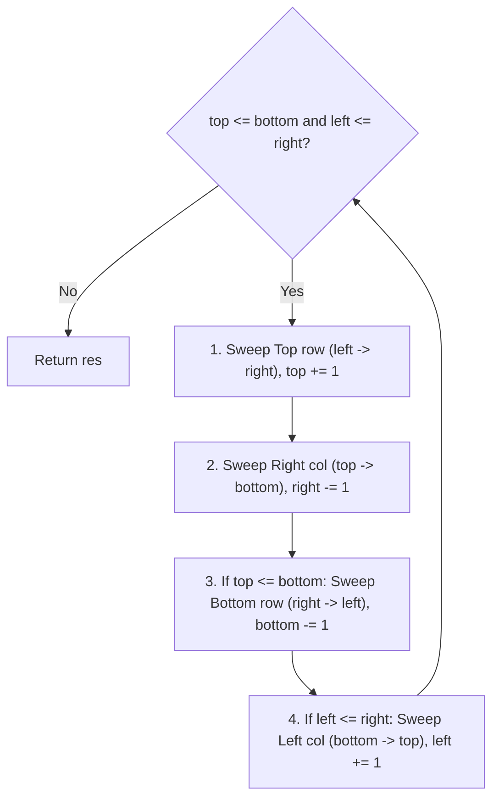

# 2D Matrix Manipulation Cheat Sheet

> Guide: [2D Matrices, Diagonals & Rotations](../01_arrays_and_pointers/00_matrix_2d_arrays_and_rotations.md)

## 1. Diagonal Coordinate Rules ($N \times N$ Grid)

| Diagonal | Coordinate Rule | Count | Example ($3 \times 3$) |
| :--- | :--- | :--- | :--- |
| **Main / Principal Diagonal** (top-left to bottom-right) | `r == c` | $1$ | `(0,0), (1,1), (2,2)` |
| **Anti-Diagonal** (top-right to bottom-left) | `r + c == N - 1` | $1$ | `(0,2), (1,1), (2,0)` |
| **All Anti-Diagonals** ($\swarrow$) | `r + c` is constant | $2N - 1$ | Sum ranges from `0` to `2N - 2` |
| **All Main Diagonals** ($\searrow$) | `r - c` is constant | $2N - 1$ | Diff ranges from `-(N-1)` to `N - 1` |

---

## 2. In-Place Transpose & 90° Rotations ($\mathcal{O}(1)$ Space)

### In-Place Transpose (Swap across Main Diagonal)
Only loop over the upper triangle (`c` from `r + 1` to `n - 1`). Looping `c` from `0` to `n - 1` swaps every pair twice and leaves the matrix unchanged.

```python
for r in range(n):
    for c in range(r + 1, n):
        matrix[r][c], matrix[c][r] = matrix[c][r], matrix[r][c]
```

### 90° Clockwise Rotation (LC 48)
**Formula:** Transpose + Reverse each row left-to-right.
```python
def rotate_clockwise(matrix: list[list[int]]) -> None:
    n = len(matrix)
    for r in range(n):
        for c in range(r + 1, n):
            matrix[r][c], matrix[c][r] = matrix[c][r], matrix[r][c]
    for row in matrix:
        row.reverse()
```

### 90° Counter-Clockwise Rotation
**Formula:** Transpose + Reverse the order of rows top-to-bottom (`matrix.reverse()`).

---

## 3. Four-Pointer Spiral Traversal (LC 54)

Maintain fourshrinking walls: `top`, `bottom`, `left`, `right`. After each edge sweep, move that wall inward by 1.

```text
top ───►  [ 1,  2,  3,  4 ]
          [ 5,  6,  7,  8 ]
bottom ─► [ 9, 10, 11, 12 ]
            ▲           ▲
           left       right
```



```python
def spiralOrder(matrix: list[list[int]]) -> list[int]:
    top, bottom = 0, len(matrix) - 1
    left, right = 0, len(matrix[0]) - 1
    res = []

    while top <= bottom and left <= right:
        for c in range(left, right + 1):      # 1. Top row (left -> right)
            res.append(matrix[top][c])
        top += 1

        for r in range(top, bottom + 1):      # 2. Right col (top -> bottom)
            res.append(matrix[r][right])
        right -= 1

        if top <= bottom:                     # Guard for single remaining row
            for c in range(right, left - 1, -1):  # 3. Bottom row (right -> left)
                res.append(matrix[bottom][c])
            bottom -= 1

        if left <= right:                     # Guard for single remaining col
            for r in range(bottom, top - 1, -1):  # 4. Left col (bottom -> top)
                res.append(matrix[r][left])
            left += 1

    return res
```
