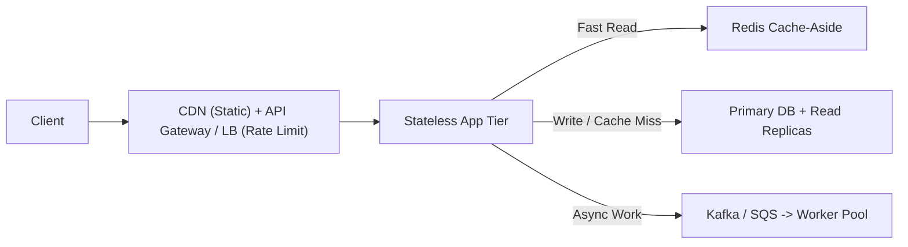

# System Design Fundamentals Cheat Sheet

## 1. Component Selection Table

| Need | Pick | Why |
| :--- | :--- | :--- |
| ACID transactions, relational joins, billing | **PostgreSQL / MySQL** | Row locks, foreign keys, strong consistency. |
| Sub-millisecond cache, rate limits, leaderboards | **Redis** | In-memory key-value/sorted-set store with TTL expiration. |
| Massive write-heavy append logs / chat history | **Cassandra / ScyllaDB** | Leaderless LSM-tree ring that scales writes linearly across nodes. |
| Unstructured blobs (photos, videos, backups) | **S3 + CloudFront CDN** | Cheap object storage paired with edge caching. |
| Full-text search & fuzzy filtering | **Elasticsearch / OpenSearch** | Inverted index built for text tokenization and relevance scoring. |
| Async background jobs & traffic buffering | **Kafka / RabbitMQ / SQS** | Decouples fast producers from slow workers and absorbs traffic spikes. |
| HTTP path/header routing & SSL termination | **L7 Load Balancer (ALB / Nginx)** | Inspects URLs, cookies, and JWT headers. |
| Ultra-fast TCP/UDP packet routing | **L4 Load Balancer (NLB)** | Routes by IP + Port at millions of packets per second. |
| One-way server push (live feeds, LLM tokens) | **Server-Sent Events (SSE)** | Standard HTTP stream with built-in browser reconnect. |
| Two-way low-latency chat or gaming | **WebSockets** | Persistent bidirectional TCP pipe. |
| Internal microservice-to-microservice calls | **gRPC (Protobuf over HTTP/2)** | Compact binary payloads and multiplexed streams. |

---

## 2. Network Protocols

| Protocol | Transport | Best For | Trade-off |
| :--- | :--- | :--- | :--- |
| **UDP** | Connectionless | Video calls, gaming, DNS | Fast, no handshake, drops lost packets instead of stalling. |
| **TCP** | 3-way handshake | Databases, web, file transfer | Guaranteed in-order delivery; lost packets stall the stream. |
| **HTTP/1.1** | TCP | Simple REST APIs | Head-of-line blocking without connection pooling. |
| **HTTP/2** | TCP | gRPC, multiplexed web assets | Multiple parallel streams over one TCP connection. |
| **HTTP/3 (QUIC)** | UDP | Mobile clients on flaky networks | Eliminates TCP head-of-line blocking and cuts handshake time. |

---

## 3. Production Readiness Checklist
- **No Single Point of Failure (SPOF):** Multi-AZ load balancers, stateless app servers, and primary + standby DB replicas.
- **Stateless App Tier:** Never store session state on local disk; keep sessions in Redis or signed JWTs.
- **Read/Write Split:** Send writes to the Primary DB and scale reads across Read Replicas (with Cache-Aside in front).
- **Edge Protection:** Rate limit by user/IP (Token Bucket) at the API Gateway.
- **Fault Isolation:** Set timeouts, exponential backoff with jitter, and circuit breakers on every downstream network call.

