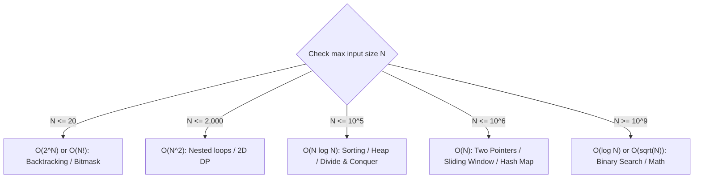

# Time & Space Complexity Cheat Sheet

> Guides: [02. Time & Space Complexity](../00_foundations/02_time_and_space_complexity_big_o.md) | [04. Factors, Primes & Iteration Counting](../00_foundations/04_factors_primes_and_iteration_counting.md)

## 1. Loop Pattern Decision Table

| Loop Pattern | Code Signature | Big O | Exact Iterations / Why |
| :--- | :--- | :--- | :--- |
| Linear scan | `for x in arr:` | $\mathcal{O}(N)$ | Visits each item once ($N$ steps). |
| Halving / doubling | `while i > 0: i //= 2` or `i *= 2` | $\mathcal{O}(\log N)$ | $\lfloor\log_2 N\rfloor + 1$ steps. |
| Square root scan | `while i * i <= N: i += 1` | $\mathcal{O}(\sqrt{N})$ | $\lfloor\sqrt{N}\rfloor$ steps (factors, prime check). |
| Independent nested | `for i in range(N): for j in range(M):` | $\mathcal{O}(N \cdot M)$ | $N \times M$ total iterations. |
| Shrinking triangle | `for i in range(N): for j in range(i, N):` | $\mathcal{O}(N^2)$ | $\frac{N(N+1)}{2}$ steps; drop the $1/2$ constant. |
| Linear outer + halving inner | `for i in range(N): while j < N: j *= 2` | $\mathcal{O}(N \log N)$ | $N \times \log_2 N$ steps. |
| Nested with immediate `break` | Inner loop `break`s on step 1 | $\mathcal{O}(N)$ | Inner loop runs $\mathcal{O}(1)$ times per outer step. |

---

## 2. Speed Hierarchy & Input Constraints ($10^8$ Ops/Sec Rule)

$$\mathcal{O}(1) < \mathcal{O}(\log N) < \mathcal{O}(\sqrt{N}) < \mathcal{O}(N) < \mathcal{O}(N \log N) < \mathcal{O}(N^2) < \mathcal{O}(2^N) < \mathcal{O}(N!)$$

| Max Input Size $N$ | Slowest Allowed Complexity | Typical Pattern |
| :--- | :--- | :--- |
| $N \le 11$ | $\mathcal{O}(N!)$ | Permutations backtracking |
| $N \le 20$ | $\mathcal{O}(2^N)$ | Subsets / bitmask recursion |
| $N \le 2,000$ | $\mathcal{O}(N^2)$ | Nested loops, 2D DP |
| $N \le 10^5$ | $\mathcal{O}(N \log N)$ | Sorting, heaps, divide & conquer |
| $N \le 10^6$ | $\mathcal{O}(N)$ | Two pointers, sliding window, hash map, prefix sum |
| $N \ge 10^9$ | $\mathcal{O}(\sqrt{N})$ or $\mathcal{O}(\log N)$ | Binary search, math / factor pairs |

---

## 3. Auxiliary Space Complexity

| Allocation | Space |
| :--- | :--- |
| Scalar variables (`l`, `r`, `cur_sum`, `max_len`) | $\mathcal{O}(1)$ |
| Recursion tree of depth $H$ (call stack frames) | $\mathcal{O}(H)$ |
| Slicing (`arr[:]`, `s[i:j]`) or hash table (`set`, `dict`) of up to $N$ items | $\mathcal{O}(N)$ |
| $N \times M$ grid or 2D DP table | $\mathcal{O}(N \cdot M)$ |

---

## 4. Simplification Rules
1. Drop constant multipliers and divisors: $5N \to \mathcal{O}(N)$, $\frac{N}{2} \to \mathcal{O}(N)$.
2. Drop lower-order terms: $N^2 + 100N + 500 \to \mathcal{O}(N^2)$.
3. Keep separate variables when inputs are independent: two arrays of length $N$ and $M$ take $\mathcal{O}(N + M)$ or $\mathcal{O}(N \cdot M)$, not $\mathcal{O}(N)$.
