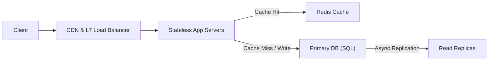

# FAANG system design 4-step interview framework

> **Target:** 45-minute Senior/Staff system design interview  
> **Context:** System design interviews test how you narrow down ambiguous requirements, size capacity, make concrete architecture choices, and reason through failure modes.

## 1. The 45-minute time breakdown

```text
[ 0m - 5m ]   Step 1: Clarify scope and requirements (functional and non-functional)
[ 5m - 10m ]  Step 2: Back-of-the-envelope math and core API design
[ 10m - 25m ] Step 3: High-level architecture diagram (end-to-end happy path)
[ 25m - 40m ] Step 4: Deep dives, bottlenecks, and scale-out trade-offs
[ 40m - 45m ] Wrap-up: Monitoring and failure scenarios
```

## 2. Step 1: Scope and clarify requirements (5 minutes)

Do not start drawing boxes right away. Spend the first few minutes locking down what you are actually building.

### Functional requirements (2 to 3 core use cases)
* Ask what primary actions a user takes.
* Keep the scope to 2 or 3 core features and explicitly park secondary features (like billing or custom analytics) unless asked.
* *Example (URL shortener):*
  1. User submits a long URL and gets back a short URL.
  2. User visits the short URL and gets redirected to the original URL.
  3. (Parked: click analytics, custom vanity aliases).

### Non-functional requirements
* **Scale:** Daily active users (DAU) and read-to-write ratio.
* **Latency:** Target p99 latency (for example, sub-50ms redirects, sub-200ms writes).
* **Availability vs. consistency (CAP):** Does the system favor availability with eventual consistency (social feeds, URL redirects) or strong consistency (payments, seat booking, inventory)?
* **Durability and retention:** How long are records retained, and can any writes be lost?

## 3. Step 2: Back-of-the-envelope math and API design (5 minutes)

### Capacity estimation template
```text
Daily Active Users (DAU):           100 Million
Writes per user/day:                1 write  ──> 100M writes / day
Reads per user/day:                 10 reads ──> 1 Billion reads / day (10:1 read-to-write ratio)

Average Write QPS:                  100,000,000 / 86,400 ≈ 1,200 writes/sec
Peak Write QPS (2x - 3x):           ~3,000 writes/sec
Average Read QPS:                   1,000,000,000 / 86,400 ≈ 12,000 reads/sec
Peak Read QPS:                      ~30,000 reads/sec

Storage per Year:                   100M writes/day * 500 bytes * 365 ≈ 18.25 TB / year
Bandwidth (Inbound):                1,200 * 500 bytes ≈ 600 KB/s
Bandwidth (Outbound):               12,000 * 500 bytes ≈ 6 MB/s
```

### Core API endpoints
```http
POST /v1/urls
Request Body:  { "original_url": "https://example.com/very/long/path", "user_id": "u123" }
Response Body: { "short_url": "https://tiny.url/aB3x9", "expires_at": 1893456000 }

GET /{short_code}
Response:      HTTP 302 Found (or 301 Moved Permanently)
Header:        Location: https://example.com/very/long/path
```

> [!TIP]
> **301 vs. 302 redirect:**
> - `301 Moved Permanently`: Browsers cache the redirect locally, which offloads repeat requests from your servers but hides click counts from your backend.
> - `302 Found` / `307 Temporary Redirect`: Browsers hit your server on every click, which lets you log click metrics and update target URLs at the cost of higher read QPS.

## 4. Step 3: High-level architecture (15 minutes)

Sketch the end-to-end happy path from client to storage:

```text
[ Client ] ──> [ DNS ] ──> [ CDN ] ──> [ Load Balancer (L7) ]
                                                │
                                                ▼
                                     [ Stateless App Servers ]
                                         │              │
                           (Cache Hit)   │              │ (Cache Miss)
                                         ▼              ▼
                                   [ Redis Cache ]  [ Primary DB (SQL) ]
                                                        │
                                                        ▼ (Replication)
                                                 [ Read Replicas ]
```



1. **State design choices aloud:** Keep the application tier stateless so instances can scale horizontally behind the load balancer.
2. **Trace both paths:** Walk through the write path and the read path (cache hit vs. cache miss) step by step.

## 5. Step 4: Deep dives and bottlenecks (15 minutes)

Pick 2 or 3 bottlenecks in your design and explain how to handle them at scale:

### Database sharding and partitioning
* When storage crosses a few terabytes or write QPS saturates a single primary node, partition across shards by `hash(short_code)` or `hash(user_id)`.
* Use consistent hashing with virtual nodes so adding or removing shards only moves a small fraction of keys.

### Cache invalidation and stampedes
* With a cache-aside setup, the app checks Redis first, falls back to the database on a miss, and populates Redis with a TTL.
* **Cache stampede (thundering herd):** If a popular key expires, thousands of concurrent requests miss the cache at once and hit the database. Prevent this with singleflight request coalescing (a per-key mutex lock) or early background refresh before the TTL expires.

### Single points of failure (SPOF)
* Run active-passive or active-active load balancers with floating virtual IPs (VRRP) or DNS Anycast.
* Deploy multi-AZ database primaries and standbys with automated failover.

## 6. Common interview mistakes

1. **Silent drawing:** Drawing boxes for minutes without narrating why each component is there.
2. **Premature complexity:** Adding Kafka, Cassandra, Kubernetes, and Spark to a problem with 50 writes per second.
3. **Ignoring physical constraints:** Proposing synchronous cross-continent database replication without accounting for the ~100-150ms speed-of-light network round trip.
4. **Generic technology labels:** Writing "NoSQL" on a box without specifying whether the workload needs a key-value store, document store, or wide-column store.
5. **Pushing back on interviewer hints:** When an interviewer points out a failure case or changes a constraint, treat it as a prompt to adjust the design rather than defending the first draft.
