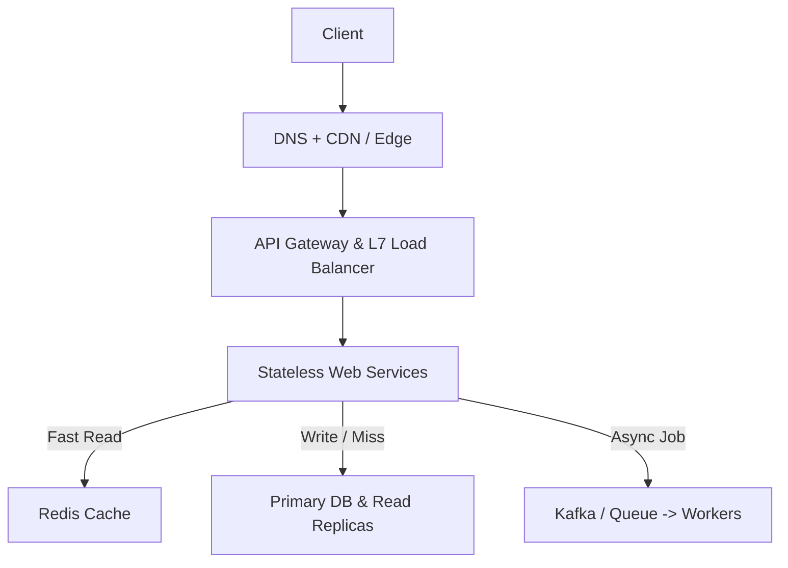

# System design foundations: production infrastructure and protocols

> **Reference source:** [Hayk Simonyan, System Design Explained (APIs, Databases, Caching, Load Balancing & Production Infra)](https://www.youtube.com/watch?v=oYxTTirKY8M)  
> **Target:** System design interview foundations  
> **Focus:** Scaling stages, database access patterns, load balancing, network protocols, and auth.

## 1. System evolution: from 1 user to 10 million users

Most production backends grow through four distinct phases as traffic scales:

```text
Phase 1: Monolithic Single Box          Phase 2: Decoupled Database
┌─────────────────────────┐             ┌──────────────┐      ┌──────────────┐
│  Client ──> [ App + DB ]│             │ App Server   │ ───> │ Database (DB)│
└─────────────────────────┘             └──────────────┘      └──────────────┘
(CPU/RAM contention, single box SPOF)   (Independent compute and storage scaling)

Phase 3: Horizontally Scaled Stateless Tier
                  ┌───> [ App Server 1 ] ──┐
[ Client ] ──> [ LB ] ─┼───> [ App Server 2 ] ──┼───> [ Primary DB ] (Writes)
                  └───> [ App Server 3 ] ──┘         │ (Replication)
                                                     ▼
                                              [ Read Replicas ] (Reads)

Phase 4: Multi-Tier Production Infrastructure
[ Client ] ──> [ DNS / Route 53 ]
                   │
                   ▼
             [ CDN / Edge ] ── (Static Assets / Cached Reads)
                   │
                   ▼
        [ API Gateway / Reverse Proxy ] ── (TLS Termination, Rate Limiting, Auth)
                   │
                   ▼
          [ Layer 7 Load Balancer ]
          ┌────────┴────────┐
          ▼                 ▼
   [ Web Service A ]  [ Web Service B ]
          │                 │
     (Sub-ms Read)     (Async Event)
          ▼                 ▼
   [ Redis Cache ]    [ Message Queue / Kafka ]
          │                 │
          ▼                 ▼
   [ Primary DB (SQL) ] [ Async Background Workers ]
          │
     (Replication)
          ▼
   [ Read Replicas ] + [ Analytical DB / Data Warehouse ]
```



## 2. Databases: matching storage to access patterns

Pick a database engine based on read/write patterns, consistency requirements, and query shapes:

| Database type | Examples | Best access pattern and use cases | Trade-offs and limitations |
| :--- | :--- | :--- | :--- |
| **Relational (SQL)** | PostgreSQL, MySQL | ACID transactions, relational joins, ledgers, payments, orders. | Harder to shard horizontally across nodes; cross-shard joins are slow. |
| **Document** | MongoDB, DynamoDB | Self-contained nested JSON documents, product catalogs, user profiles. | Multi-document transactions add overhead; denormalization duplicates data. |
| **Key-value** | Redis, Memcached | Sub-millisecond lookups by key, session storage, rate limiting, leaderboards. | Cannot query by non-key attributes without maintaining secondary indexes. |
| **Wide-column** | Apache Cassandra, ScyllaDB | High write throughput, append-heavy time-series logs, messaging history, IoT telemetry. | Tunable/eventual consistency; queries must match partition and clustering keys; no joins. |
| **Graph** | Neo4j, AWS Neptune | Multi-hop relationship traversals, social graphs, fraud ring detection. | Hard to partition cleanly across machines. |

## 3. Scaling: vertical vs. horizontal

```text
Vertical Scaling (Scale UP):             Horizontal Scaling (Scale OUT):
┌───────────┐     ┌───────────────┐     ┌─────────┐   ┌─────────┐   ┌─────────┐
│ Small Box │ ──> │ Large Host    │     │ Node 1  │ + │ Node 2  │ + │ Node 3  │
│ 4 vCPU    │     │ 128 vCPU/4TB  │     └─────────┘   └─────────┘   └─────────┘
└───────────┘     └───────────────┘     (Behind a Load Balancer)
```

* **Vertical scaling (scale up):**
  * **Pros:** No code changes, no network hops between nodes, simple consistency.
  * **Cons:** Hardware limits on CPU/RAM/IOPS, steep cost curve on large instances, single point of failure during reboots.
* **Horizontal scaling (scale out):**
  * **Pros:** Scales capacity by adding commodity machines; survives individual node failures.
  * **Cons:** Requires stateless application servers (moving session state to Redis or tokens) and introduces distributed data consistency problems.

## 4. Load balancing and traffic routing

A load balancer spreads incoming requests across healthy backend instances.

### Layer 4 vs. Layer 7 load balancing
* **Layer 4 (Transport layer, TCP/UDP):**
  * Routes packets based on IP address and TCP/UDP port (for example, AWS NLB).
  * Does not parse HTTP headers or bodies.
  * Handles millions of connections per second with very low latency overhead.
* **Layer 7 (Application layer, HTTP/HTTPS):**
  * Terminates TLS, inspects HTTP paths, headers, and cookies, and routes requests based on content (for example, AWS ALB, NGINX, Envoy, HAProxy):
    * `/api/v1/users` $\to$ User service
    * `/api/v1/video` $\to$ Streaming service

### Routing algorithms
1. **Round robin:** Cycles through backend servers sequentially. Works when all servers have identical specs and request costs are uniform.
2. **Weighted round robin:** Assigns a weight to each server proportional to its CPU/RAM capacity.
3. **Least connections:** Routes each new request to the server with the fewest active connections. Helpful for WebSockets or requests with high variance in processing time.
4. **Least response time:** Combines active connection count with recent response latency.
5. **IP hash / consistent hashing:** Hashes client IP or request key so repeat requests hit the same backend node (useful for local in-memory caches).

### Health checks and load balancer redundancy
* **Active health checks:** The load balancer polls an endpoint like `GET /healthz` every few seconds and removes a backend after $N$ consecutive failures.
* **Passive health checks:** The load balancer watches live traffic for connection resets or `5xx` spikes and trips a circuit breaker for that node.
* **Preventing load balancer SPOF:** Run active-passive pairs sharing a floating Virtual IP (VIP) via VRRP/Keepalived, or active-active clusters behind DNS and BGP Anycast.

## 5. Networking and transport protocols

### TCP vs. UDP
```text
TCP: 3-Way Handshake (Reliable, Ordered)     UDP: Connectionless (Fast, Unordered)
Client              Server                  Client              Server
  │─── SYN ──────────>│                       │─── Datagram 1 ───>│
  │<── SYN-ACK ───────│                       │─── Datagram 2 ───>│ (Dropped)
  │─── ACK ──────────>│                       │─── Datagram 3 ───>│
  │─── Data Stream ──>│
```

* **TCP (Transmission Control Protocol):**
  * Guarantees delivery and byte ordering via sequence numbers, ACKs, retransmissions, and congestion control.
  * *Used for:* HTTP/HTTPS, database wire protocols, SSH, file transfers, SMTP.
* **UDP (User Datagram Protocol):**
  * Sends datagrams with no handshake, no head-of-line blocking, and no automatic retransmission.
  * *Used for:* Live video/audio conferencing (WebRTC), multiplayer game state sync, DNS queries, HTTP/3 (QUIC builds reliability and multiplexing on top of UDP).

## 6. API styles: REST vs. GraphQL vs. gRPC

| Feature | REST | GraphQL | gRPC |
| :--- | :--- | :--- | :--- |
| **Transport** | HTTP/1.1 or HTTP/2 | HTTP/1.1 or HTTP/2 | HTTP/2 (multiplexed streams) |
| **Payload format** | JSON (text) | JSON (text) | Protocol Buffers (binary) |
| **Schema contract** | Optional (OpenAPI) | Required (`schema.graphql`) | Required (`.proto` definition) |
| **Data fetching** | Fixed resource endpoints; can over-fetch or require multiple round trips. | Client specifies exact fields needed in a single query. | Typed RPC methods and unary/bidirectional streaming. |
| **HTTP caching** | Built-in via `GET` URLs, `Cache-Control`, and CDN edge caching. | Harder at the CDN layer since queries use `POST /graphql`. | Handled in application code. |
| **Best fit** | Public APIs, standard CRUD web services. | Mobile and web clients fetching nested graphs of UI data. | Low-latency internal service-to-service RPC. |

## 7. Real-time server-to-client communication

```text
Short Polling:          Long Polling:           Server-Sent Events:     WebSockets:
(Repeated Pings)        (Held Connection)       (Unidirectional Stream) (Full-Duplex Pipe)

Client   Server         Client   Server         Client   Server         Client   Server
  │─Data?─>│              │─Data?─>│              │──Connect─>│           │<═ Handshake ═>│
  │<─No────│              │   :    │              │<─Event 1──│           │<══ Msg A ════>│
  │        │ (wait)       │ (wait) │              │<─Event 2──│           │<══ Msg B ════>│
  │─Data?─>│              │   :    │              │<─Event 3──│           │<══ Msg C ════>│
  │<─Yes───│              │<─Data──│              (HTTP Stream)           (Bidirectional)
```

1. **Short polling:** Client polls on a fixed timer (for example, every 3 seconds). Simple, but wastes requests when nothing changes.
2. **Long polling:** Server holds the HTTP request open until an event arrives or a timeout hits, then the client reconnects immediately.
3. **Server-Sent Events (SSE):** One-way stream (server $\to$ client) over standard HTTP (`text/event-stream`). Good for live feeds, notifications, and streaming LLM tokens.
4. **WebSockets:** Persistent full-duplex TCP connection upgraded from HTTP. Used when both client and server send frequent low-latency messages (chat, collaborative docs, games).

## 8. Authentication and authorization

### Authentication (AuthN: verifying identity)
* **Stateful session cookies:**
  * On login, the server writes a session record to Redis and sets an `HttpOnly`, `Secure` cookie (`session_id=xyz`).
  * *Pros:* Immediate session revocation by deleting the key in Redis.
  * *Cons:* Every authenticated request hits the session store.
* **Stateless JWTs (JSON Web Tokens):**
  * Server signs a short-lived token (`header.payload.signature`) with a private key (RS256/ES256) or shared secret (HS256).
  * *Pros:* Services verify signatures locally using the public key without querying a central store.
  * *Cons:* Cannot revoke an individual token before its `exp` timestamp without adding a denylist check; keep access token TTLs short (5 to 15 minutes) paired with rotatable refresh tokens.
* **OAuth 2.0 and OIDC:**
  * Delegated authorization and identity federation ("Sign in with Google/GitHub") using authorization codes and ID tokens.

### Authorization (AuthZ: checking permissions)
* **RBAC (Role-Based Access Control):** Users are assigned roles (`admin`, `editor`, `viewer`), and permissions attach to roles.
* **ABAC (Attribute-Based Access Control):** Policies evaluate attributes of the user, resource, action, and context (for example, allow if `user.org_id == doc.org_id` and `request.ip` is on the corporate network).

## 9. Edge security checklist

* **TLS in transit:** Terminate TLS 1.3 at the edge/load balancer and use mTLS between internal services when zero-trust networking is required.
* **Rate limiting:** Throttle abusive IPs and API keys at the gateway using token bucket or sliding window counters.
* **CORS (Cross-Origin Resource Sharing):** Restrict browser cross-origin reads using explicit `Access-Control-Allow-Origin` allowlists.
* **CSRF (Cross-Site Request Forgery):** Set `SameSite=Lax` or `Strict` on session cookies and validate CSRF tokens on state-changing requests.
* **DDoS protection:** Absorb volumetric L3/L4 floods at Anycast CDN edges (Cloudflare, AWS Shield) and filter L7 bot spikes via WAF rules.
