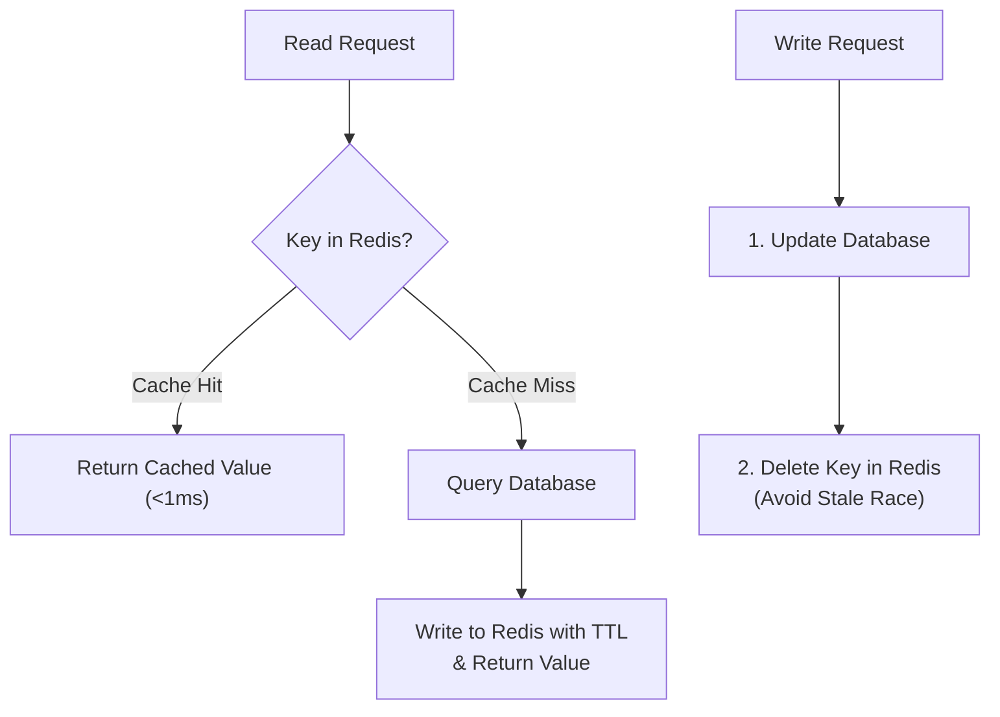

# Caching strategies, failure modes, and Redis data structures

> **Target:** System design interviews  
> **Core concept:** Putting an in-memory cache between application servers and disk databases drops read latency from ~10-50ms down to <1ms and shields the database from read spikes.

## 1. Four core caching patterns

```text
1. Cache-Aside (Lazy Loading)              2. Write-Through
   App ──1. Check Cache─> [ Cache ]           App ──1. Write Data──> [ Cache ]
    │         │ (Miss)                                                    │
    │         ▼                                                           ▼ 2. Synchronous Write
    └───2. Read DB─────> [ Database ]                                [ Database ]

3. Write-Behind (Write-Back / Async)       4. Refresh-Ahead
   App ──1. Write Data──> [ Cache ]           App ─── Read Data ───> [ Cache ]
                            │                                            ▲
                            │ (Async Batch Write)                        │ (Auto-Refresh before expiry)
                            ▼                                            │
                       [ Database ]                                 [ Database ]
```



| Pattern | Read path | Write path | Pros | Cons and failure modes |
| :--- | :--- | :--- | :--- | :--- |
| **Cache-aside (lazy loading)** | Check cache; on miss, read DB, populate cache with TTL, return data. | Write directly to DB, then delete (invalidate) the cache key. | Only caches data that is actually read; survives cache cluster downtime. | First read pays a cache-miss penalty (3 network hops); race conditions if a concurrent read repopulates stale data during a write. |
| **Write-through** | Read from cache. | Write to cache and DB synchronously before returning success. | Cache is never stale relative to completed writes. | Every write pays the latency of both cache and DB; caches cold data that may never be read again. |
| **Write-behind (write-back)** | Read from cache. | Write to cache in memory and return immediately; flush batches to DB asynchronously. | Absorbs heavy write bursts (counters, view counts, telemetry). | Data loss if the cache node crashes before dirty keys flush to disk. |
| **Refresh-ahead** | Read from cache. | Background worker refreshes hot keys just before their TTL expires. | Avoids cache-miss latency spikes on predictable hot keys. | Wastes DB reads if access patterns shift and refreshed keys go cold. |

> [!NOTE]
> **Why delete the cache key instead of updating it on cache-aside writes?**
> If two concurrent requests update the database in order $A \to B$, but their cache updates arrive over the network in order $B \to A$, the cache stays permanently stuck with stale value $A$. Deleting the key forces the next read to fetch the latest committed row from the database.

## 2. Cache eviction policies

When memory fills up (`maxmemory` in Redis), the cache evicts keys according to its configured policy:

1. **LRU (Least Recently Used):** Evicts the key that has gone the longest without being read or written. Good default for general workloads.
2. **LFU (Least Frequently Used):** Tracks access frequency (using a Morris counter in Redis) and evicts keys with the lowest hit count. Keeps consistently popular keys in memory even if a batch scan touches many one-off keys.
3. **FIFO (First-In, First-Out):** Evicts the oldest inserted key regardless of how often it is read.
4. **TTL (Time-To-Live):** Attaches an expiration timestamp to keys (`SET key val EX 3600`). Redis expires keys both lazily on read and actively via background sampling.

## 3. Three cache failure scenarios

### 1. Cache penetration (queries for non-existent keys)
* **Problem:** Clients or attackers request keys that do not exist in the cache or the database (such as `user_id = -999999`). Every request misses the cache and hits the database.
* **Fixes:**
  1. **Cache negative results:** Write `key -> NULL` into Redis with a short TTL (30 to 60 seconds).
  2. **Bloom filter:** Maintain a Bloom filter of valid keys in front of the cache. If the Bloom filter reports the key is not present, return `404` immediately without querying Redis or the database.

### 2. Cache avalanche (mass simultaneous expiration)
* **Problem:** A batch job loads 100,000 keys with an identical 1-hour TTL, or a cache shard reboots. When the TTL hits zero, all 100,000 keys expire at the same second and redirect full read traffic to the database.
* **Fix:**
  * **Add TTL jitter:** Add a random offset to every TTL (`ttl = 3600 + random.randint(0, 300)`) so expirations spread out over a 5-minute window.

### 3. Cache breakdown / stampede (hot key expiration)
* **Problem:** A single hot key receiving 50,000 reads/sec (like a celebrity post or homepage config) expires. Before the first miss finishes querying the database and writing back to Redis, thousands of concurrent requests also miss and run duplicate database queries.
* **Fixes:**
  1. **Singleflight / mutex lock:** On a cache miss, only one worker acquires a short lock (`SET lock:key 1 NX PX 2000`), queries the database, and refills Redis while other callers wait or read slightly stale data.
  2. **Logical expiration:** Never set a hard Redis TTL on known hot keys; store a logical `expires_at` timestamp inside the value payload and trigger a single background refresh when a reader sees the logical timestamp has passed.

## 4. Redis data structures in system design

| Data structure | Common system design use cases | Example commands and sizing |
| :--- | :--- | :--- |
| **String** | Key-value caching, atomic counters, simple locks. | `GET`, `SET key val NX EX 10`, `INCR page:views`. |
| **Hash** | Storing flat object fields without re-serializing the whole JSON blob. | `HSET user:101 name "Ada" plan "pro"`, `HINCRBY`. |
| **Sorted Set (ZSET)** | Real-time leaderboards, priority queues, sliding-window rate limiters (SkipList + hash table, $\mathcal{O}(\log N)$ updates). | `ZADD leaderboard 950 "u1"`, `ZREVRANGE leaderboard 0 9`. |
| **List / Stream** | Activity timelines (`List`), durable consumer-group event streams (`Stream`). | `LPUSH`, `XADD`, `XREADGROUP`. |
| **Bitmap** | Per-user boolean flags (daily active users, feature flags) using 1 bit per integer user ID. | `SETBIT dau:2026-10-17 48291 1`, `BITCOUNT` (~12 MB for 100M users). |
| **HyperLogLog** | Counting unique visitors or distinct elements with ~0.81% standard error in a fixed 12 KB footprint. | `PFADD unique:page:1 "ip1" "ip2"`, `PFCOUNT`. |
