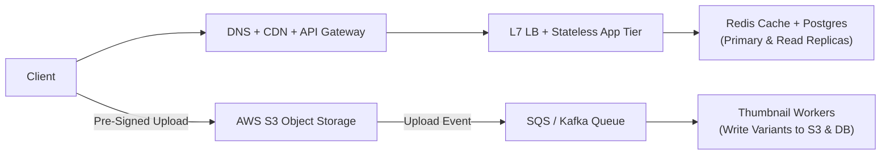

# Excalidraw dry-run 1: production architecture foundations

> **Time target:** 20 to 25 minutes  
> **Setup:** Open [Excalidraw](https://excalidraw.com) on a blank canvas.  
> **Rule:** Draw from memory for the first 15 minutes and talk through each component aloud as if explaining it to an interviewer.

## 1. Prompt

> **"Design the core web infrastructure for a photo-sharing application handling 50,000 requests per second at 99.99% availability."**

## 2. Five stages to draw on your canvas

### Stage 1: Edge layer (minutes 0 to 5)
- [ ] Draw **client devices** (iOS, Android, web browsers).
- [ ] Add **DNS (Route 53 / Anycast)** resolving the domain.
- [ ] Add a **CDN (CloudFront / Cloudflare)** serving cached thumbnails and static assets from edge POPs.
- [ ] Add an **API gateway / reverse proxy** handling TLS termination, auth token validation, and rate limiting.

### Stage 2: Load balancing and stateless compute (minutes 5 to 10)
- [ ] Place an **active-passive or active-active Layer 7 load balancer** running `/healthz` checks.
- [ ] Draw an auto-scaling group of **stateless application servers** behind the load balancer.
- [ ] Show path-based routing splitting traffic across services (for example, `/v1/users` vs. `/v1/photos` vs. `/v1/feed`).

### Stage 3: Storage and caching tier (minutes 10 to 15)
- [ ] Add a **Redis cluster** for session/auth caching and hot metadata lookups.
- [ ] Add a **primary relational database (PostgreSQL)** for user accounts, photo metadata, and social graph edges.
- [ ] Add **read replicas** receiving asynchronous replication from the primary to offload read traffic.
- [ ] Add **object storage (AWS S3)** for storing raw uploaded photos and resized image variants (using pre-signed upload URLs so multi-megabyte uploads go directly from client to S3).

### Stage 4: Asynchronous media processing (minutes 15 to 20)
- [ ] When a user uploads a photo, generate 3 thumbnail resolutions asynchronously without blocking the upload response.
- [ ] Add a **message queue (SQS / Kafka)** triggered when a new object lands in S3.
- [ ] Add **image processing workers** that pull jobs from the queue, generate thumbnails, write them back to S3, and update metadata in Postgres.

## 3. Self-critique questions

1. **What happens if App Server 2 crashes mid-request?**
   * *Answer:* The load balancer stops routing to it after failed health checks, and clients retry against the remaining stateless servers without losing session state.
2. **What happens if the primary database node fails?**
   * *Answer:* Read replicas continue serving reads while a multi-AZ standby replica is promoted to primary within ~15 to 30 seconds.
3. **Why keep session state in Redis instead of local server memory?**
   * *Answer:* Local memory ties a user's session to a single machine, which requires sticky sessions and logs users out whenever an instance scales down or crashes.
4. **Why store photo binaries in S3 instead of `BYTEA` columns in PostgreSQL?**
   * *Answer:* Multi-megabyte blobs bloat database buffer pools, slow down backups and replication, and cost far more per GB than object storage. Storing binaries in S3 and keeping only the object URL and metadata in Postgres lets the CDN cache images directly from S3.
